# LLMs Do Not Automatically Remember Chats — So How Do They Remember?

An LLM can appear to remember your name, earlier questions, and preferences. In most chat applications, this continuity comes from the **application storing information and supplying the relevant parts to the model again**.

These notes follow the thirteen supplied pictures in order. Each picture is redrawn using a diagram or equation, followed by a refined explanation. The original pictures are included in expandable sections for reference.

## Contents

1. [An LLM as a parameterized mathematical function](#1-an-llm-as-a-parameterized-mathematical-function--picture-1)
2. [Why model calls are stateless](#2-why-model-calls-are-stateless--picture-2)
3. [The apparent memory deadlock](#3-the-apparent-memory-deadlock)
4. [Context window and in-context learning](#4-the-context-window--picture-3)
5. [Conversations and short-term memory](#6-how-chatbots-implement-short-term-memory)
6. [Three limitations of short-term memory](#7-limitation-1-fragile-storage-and-restoring-a-conversation)
7. [Long-term memory and its types](#10-the-solution-selective-long-term-memory--picture-7)
8. [Creating, storing, retrieving, and injecting memories](#12-step-1-create-or-update-memories--picture-9)
9. [Challenges and a complete example](#16-the-challenges-of-long-term-memory--picture-13)

## 1. An LLM as a parameterized mathematical function — Picture 1

### Redraw

$$
y = f_{\theta}(x)
$$

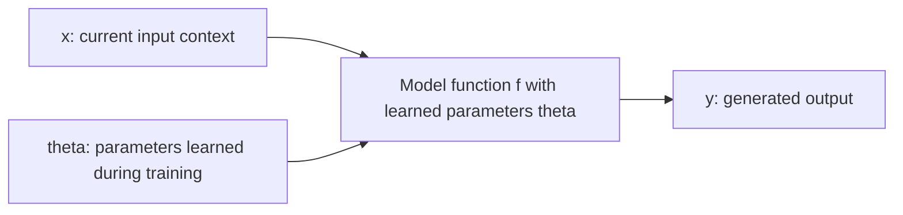

<details>
<summary>Original Picture 1</summary>

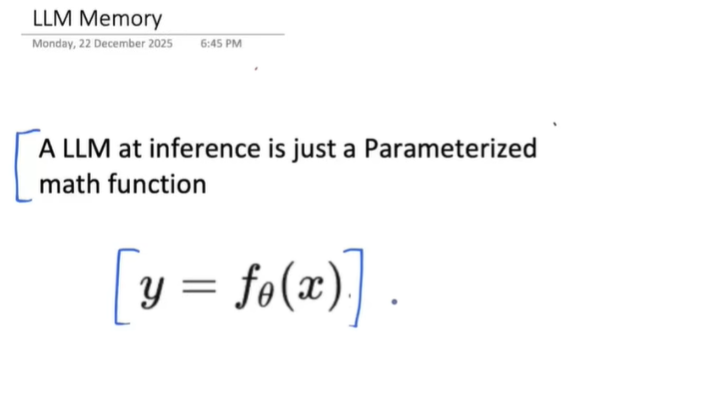

</details>

### What is a parameterized function?

A parameterized function is a mathematical rule whose behavior depends on a set of adjustable values called **parameters**. To understand the idea, start with a small function:

$$
y = ax + b
$$

Here, `a` and `b` are parameters. If `a = 2` and `b = 3`, the rule becomes `y = 2x + 3`. Changing the input `x` changes the result, while changing the parameters changes the rule itself.

An LLM is vastly more complex, but the distinction is similar:

| Symbol | Meaning in this simplified view |
| --- | --- |
| `theta` / θ | The collection of learned model parameters, including weight matrices. |
| `x` | The input supplied for the current generation. |
| `f` | The computation performed by the model. |
| `y` | The resulting prediction or generated response. |

### Theta: parameters learned during training

Large models can have billions of parameters. Training adjusts them so the model learns patterns in language and other training data. Their exact number depends on the model; “billions” is a common scale, not a requirement for every language model.

During ordinary inference, these parameters are normally fixed. Asking a question does not automatically run a training step or rewrite the model's weights to store the conversation.

The parameters encode **parametric knowledge** from training. Therefore, “LLMs have no memory” needs qualification: they have learned information in their parameters, but they do not automatically maintain an editable personal chat history across independent requests.

### X: the input varies

The user supplies a query, but `x` usually contains more than that query. The application may assemble instructions, previous messages, tool outputs, retrieved passages, and saved preferences into the current input.

With the same model parameters:

```text
Input A: What is my name?
Input B: Earlier, the user said their name is Musa. What is their name?
```

These inputs provide different evidence, so the model can answer differently without changing its weights. The output depends on both the learned model and the supplied context.

The equation is a teaching simplification. An autoregressive model predicts the next token from the context, then repeats this process using the generated prefix. Sampling settings and randomness can affect the final text, so fixed parameters and identical input do not always guarantee identical responses.

## 2. Why model calls are stateless — Picture 2

### Redraw

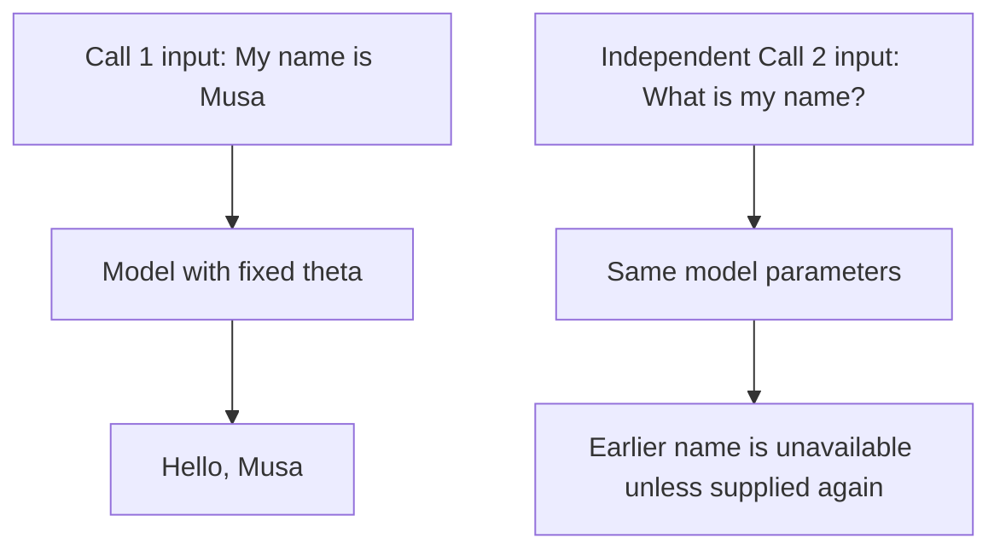

<details>
<summary>Original Picture 2</summary>

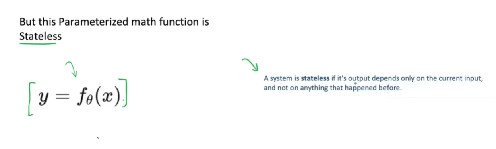

</details>

A stateless interface does not automatically carry application state from one request into the next. If the second request contains no earlier messages or restored context, the model has no reliable basis for recalling what this user said in the first request.

It may know that “Musa” is a name from training. That does not mean it knows that the current user introduced themselves as Musa in an earlier independent call.

This distinction concerns **cross-call conversation state**. During generation, the model uses the current sequence and may maintain computational caches. Those caches do not by themselves create durable user memory across chats.

Some application or API interfaces maintain conversation objects or accept references to earlier interactions. They can make the client experience stateful by managing prior context. The storage and orchestration layer still supplies the continuity; the model's weights are not automatically updated with each exchange.

## 3. The apparent memory deadlock

Many conversational applications need continuity:

- “Explain that again” requires knowing what “that” refers to.
- A project assistant needs the constraints agreed upon earlier.
- A tutoring assistant benefits from knowing the student's current exercise.
- A personal assistant may need a saved preference across conversations.

If the model does not automatically retain independent calls, how can these applications work?

The solution is to place memory in the **system around the model**. The application stores useful information and constructs a suitable input on each call.

This is an architectural problem with a practical solution, rather than a literal deadlock. Not every generative AI application needs memory: a one-shot translation or standalone classification can work with only its current input. Multi-turn assistants need some way to recover relevant prior information.

## 4. The context window — Picture 3

### Redraw: the camera-lens analogy

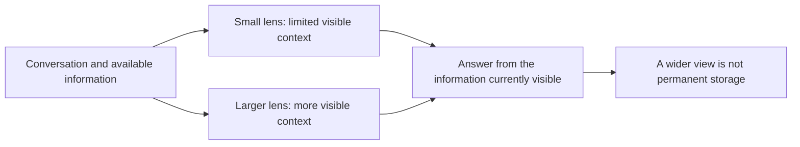

<details>
<summary>Original Picture 3</summary>

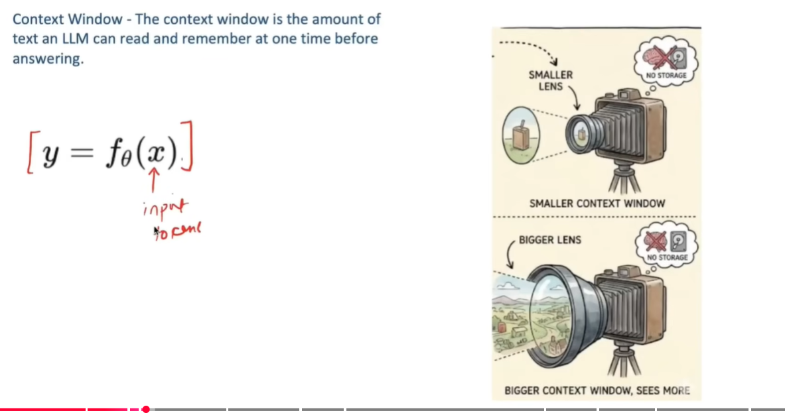

</details>

The **context window** is the model's bounded capacity for processing tokens in a generation. The usable budget must account for the model's rules about input, output, and, where applicable, other token categories.

For a text chatbot, the input may include system instructions, conversation history, the latest question, tool schemas, tool results, and retrieved memories. Tokens are not identical to words: a word may occupy several tokens, and structured data can consume many tokens too.

The camera analogy is useful: a bigger lens can see more of the scene at once. A bigger context window can expose more information to the model in the current interaction. Neither capability guarantees that every detail will be used correctly or stored permanently.

“Remember” here means **use information currently available in context**, not retain it forever after the call ends.

## 5. In-context learning — Picture 4

### Redraw

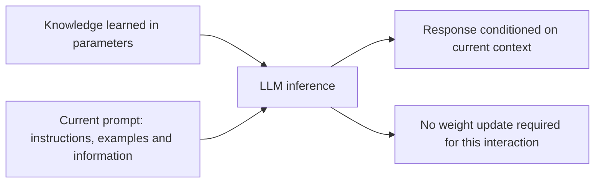

<details>
<summary>Original Picture 4</summary>

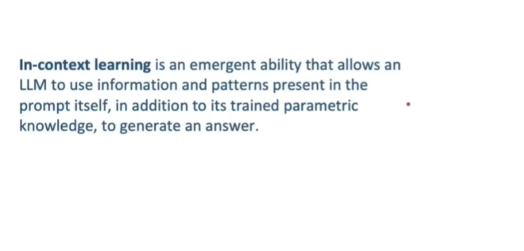

</details>

**In-context learning** describes adapting behavior using patterns, instructions, or demonstrations supplied in the input, without a task-specific weight update during that interaction. A foundational reference is Brown et al. (2020), [Language Models are Few-Shot Learners](https://arxiv.org/abs/2005.14165), which evaluated GPT-3 with text-supplied instructions and examples.

For conversation memory, the related practical ability is **using supplied context**: the model can answer based on earlier messages included in the current input. Replaying history is not necessarily few-shot learning, because it may supply facts and references rather than task demonstrations.

Consider this input:

```text
Human: My name is Musa.
Assistant: Nice to meet you, Musa.
Human: What is my name?
```

The model can respond “Your name is Musa” because the name is present in the current input. It has not needed to change theta.

### How the two principles work together

The **context window** determines how much information can be supplied at once. **Contextual use and in-context learning** explain how the model can make use of that information.

The application assembles history and the current query into the prompt. Chat APIs normally preserve structured roles such as human, assistant, and tool rather than literally joining everything into an unstructured string. Conceptually, the model receives one current context containing the selected information.

## 6. How chatbots implement short-term memory

### 6.1 Conversations and threads

A **conversation**, or **thread**, groups related turns. A turn consists of a user request and the work or replies generated in response. A thread ID identifies which conversation state should be loaded.

```text
Thread A: Python practice
Thread B: Trip planning
Thread C: Database design
```

Keeping these separate prevents the latest travel question from automatically inheriting the entire Python discussion.

### 6.2 The messages list grows within a thread

A simple chatbot keeps a list of messages:

```text
After turn 1:
[Human: My name is Musa, AI: Hello Musa]

Before answering turn 2:
[Human: My name is Musa, AI: Hello Musa, Human: What is my name?]

After turn 2:
[Human: My name is Musa, AI: Hello Musa,
 Human: What is my name?, AI: Your name is Musa]
```

Before each model call, the application supplies the relevant prior messages together with the new question. The model appears to remember because the application keeps reminding it.

In LangGraph, this message history commonly lives under `state["messages"]`. An appropriate reducer, such as `add_messages`, merges new messages into state. A tool-using agent may also retain tool requests and results, not just alternating human and assistant text.

### 6.3 Short-term means thread-scoped

**Short-term memory (STM)** tracks information belonging to the current thread. Its scope is more important than its age: a checkpointed thread reopened weeks later still represents thread-scoped memory.

The complete stored history and the context sent to the model are not necessarily identical. A long thread may be stored in full while only a summary and recent messages are sent for generation.

## 7. Limitation 1: fragile storage and restoring a conversation

### The problem

If the application holds history only in a temporary list, replacing that list, clearing a session, or restarting the process can lose the information. Switching to a new conversation usually selects a different, initially empty state.

However, **switching threads does not inherently delete the old thread**. It simply stops using that thread as the active context. Whether its state still exists depends on the application's storage design.

### Persistence addresses durability

```text
Thread A messages -> save A's checkpoint
Switch to B       -> load B's separate state
Return to A       -> restore A's state using A's thread ID
Next message      -> continue using A's selected context
```

An in-memory saver can retain checkpoints while its Python process and saver instance remain alive. A database-backed saver can preserve them across application restarts when its database storage is retained.

For a LangGraph chatbot, the pattern is:

```python
config = {"configurable": {"thread_id": selected_thread_id}}
snapshot = chatbot.get_state(config)
messages_for_display = snapshot.values.get("messages", [])
```

Render the restored messages in the UI and use the same thread ID for the next invocation. With checkpointing and a message reducer, supply the new user message rather than recreating the entire history as new message objects on every turn.

Checkpoints can include other graph-state fields in addition to messages. A separate chat registry helps the sidebar find saved threads and their titles. [LangGraph persistence guide](https://docs.langchain.com/oss/python/langgraph/persistence).

**What persistence fixes:** returning to the same saved conversation. **What it does not automatically fix:** sharing selected information with a different conversation.

## 8. Limitation 2: the context-window problem — Picture 5

### Redraw

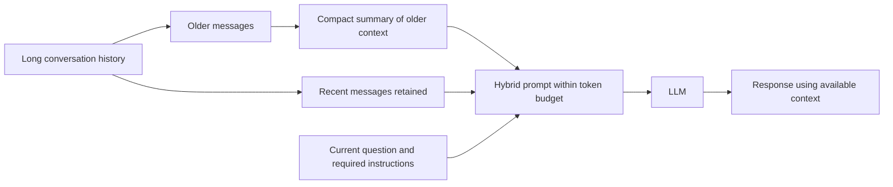

<details>
<summary>Original Picture 5</summary>

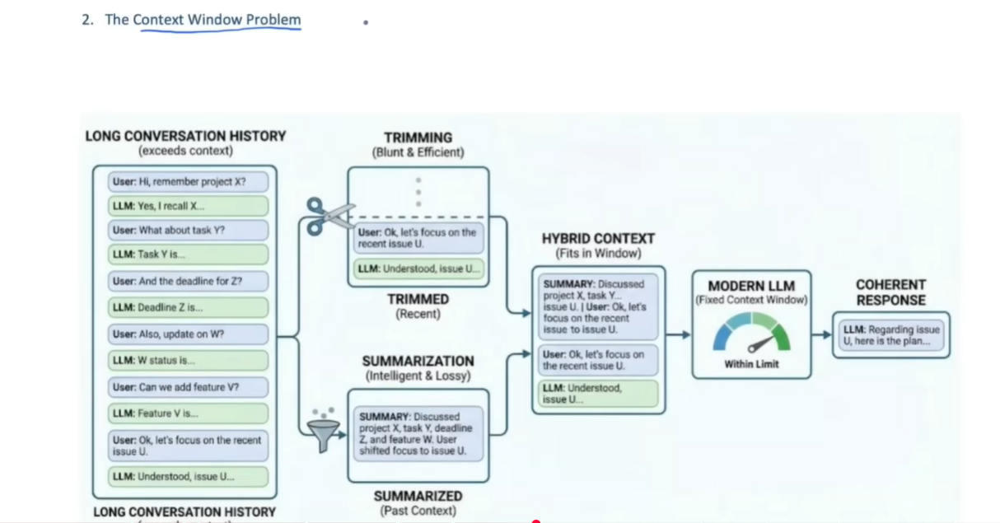

</details>

### 8.1 A growing list eventually becomes too large

As a thread grows, its tokenized messages may exceed the allowed request budget. Tool results, code blocks, and retrieved documents can accelerate that growth.

If the hard limit is exceeded, many APIs reject the request; some systems truncate or compact input according to their configuration. It is inaccurate to say that an oversized request simply makes the model hallucinate. Even within the allowed window, long or distracting context can make relevant details harder to use and increase cost and latency. [Managing short-term memory](https://docs.langchain.com/oss/python/langgraph/add-memory).

### 8.2 Trimming

Trimming selects a recent portion of the conversation for the next model call. For example, keep the last 50 messages rather than sending every message ever stored.

That is a simple starting policy, not a reliable token limit. Fifty short messages and fifty code-heavy messages can have very different sizes. A production policy should measure or conservatively estimate tokens and preserve valid message structure, including tool-call/result pairs.

Trimming the prompt need not delete the full stored transcript. Keep “what is stored” separate from “what is sent now.”

### 8.3 Summarization

Summarization compresses older history into a shorter representation containing facts, decisions, constraints, and unresolved tasks.

```text
Older discussion summary:
The user is learning LangGraph, prefers simple Python examples,
and is building a chatbot with SQLite checkpoints.
The open task is restoring messages from a sidebar selection.
```

A summary is lossy. It may omit an exact identifier or distort a detail, so preserve critical values separately and keep source history available when needed.

### 8.4 Combine both approaches

For an illustrative 120-message conversation:

```text
Messages 1–70   -> summarize older context
Messages 71–120 -> retain the latest 50 messages
Current query  -> append once if not already in the retained messages
```

Assemble the next input from instructions, the older-history summary, the recent messages, and the current query. If the current query was already appended to the history list, do not append it a second time.

Before sending, check the total budget. Reserve space for the intended output and any model-specific overhead. If the older portion itself is too large to summarize in one request, process it in smaller groups and update a running summary.

```text
Input budget = model's usable budget
             - reserved output capacity
             - required overhead

Selected input = instructions + summary + recent history
               + current query + other required context
```

This combination often preserves continuity more efficiently, but it does not guarantee coherent or factually correct answers. Evaluate whether summaries retain the information your application actually needs.

## 9. Limitation 3: STM is thread-scoped — Picture 6

### Redraw

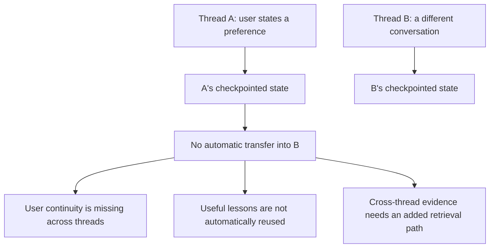

<details>
<summary>Original Picture 6</summary>

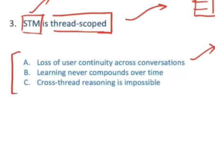

</details>

Suppose the user says in Thread A, “I prefer explanations with small Python examples.” In Thread B, the application loads B's state. A's preference does not automatically appear there, even if A's complete history is safely stored in a database.

This is the key distinction:

```text
Persistence: Can I reopen Thread A?
Cross-thread memory: Can an appropriate fact from A help in Thread B?
```

The picture describes lost continuity, non-compounding learning, and impossible cross-thread reasoning. More precisely, these capabilities are **not provided by isolated thread history alone**. They become possible when the application adds authorized retrieval of selected cross-thread information.

Reopening A is not the same as helping B. Copying every old transcript into B is usually unnecessary, expensive, and likely to introduce irrelevant material. We need a more selective design.

## 10. The solution: selective long-term memory — Picture 7

### Redraw

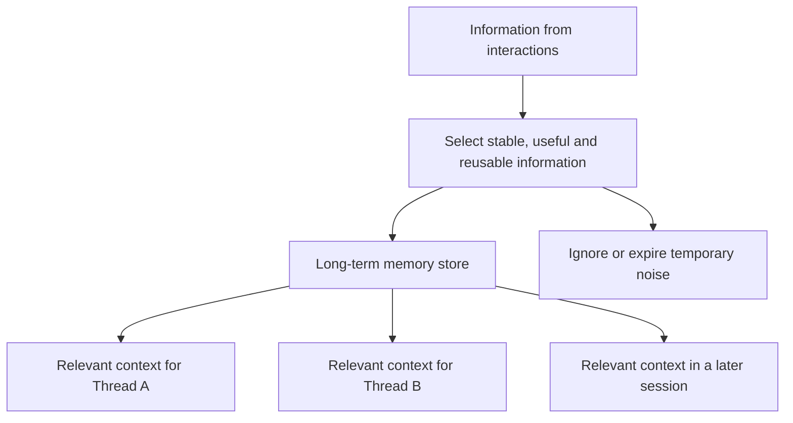

<details>
<summary>Original Picture 7</summary>

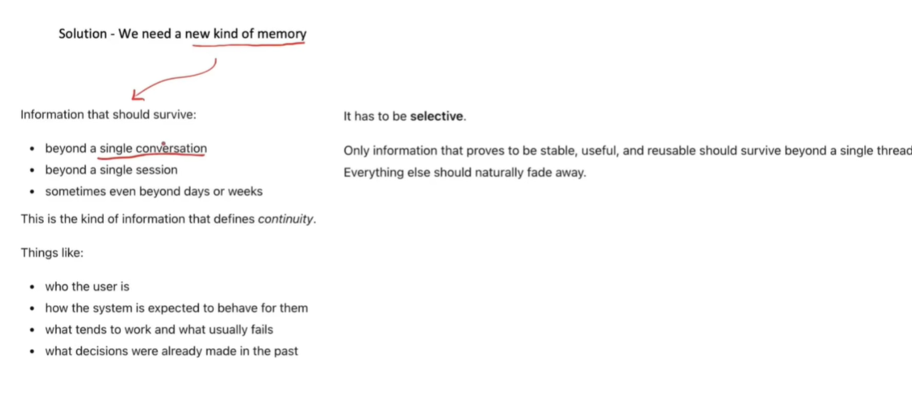

</details>

**Long-term memory (LTM)** stores selected information outside one thread so it can be recalled in other appropriate conversations. It can include a user's preferences, important decisions, relevant experiences, and approved ways of working.

Useful examples include:

- “This user prefers Python examples.”
- “The current project uses PostgreSQL.”
- “The user rejected a proposed deployment because it required a paid service.”
- “For this application, explain a migration plan before proposing schema changes.”

Long-term memory is not an instruction to save everything. Temporary statements, unsupported guesses, obsolete facts, and sensitive details that should not be retained need different treatment.

The application chooses scope: some memories belong to one user, others to a project or organization, and some to the agent itself. Information should cross threads only within its intended scope.

The labels STM and LTM describe **recall scope**, while RAM and database describe **storage durability**. A thread checkpoint can live in a database and still be STM. A shared in-memory store can demonstrate LTM behavior across threads but lose its contents on restart.

## 11. Three types of long-term memory — Picture 8

### Redraw

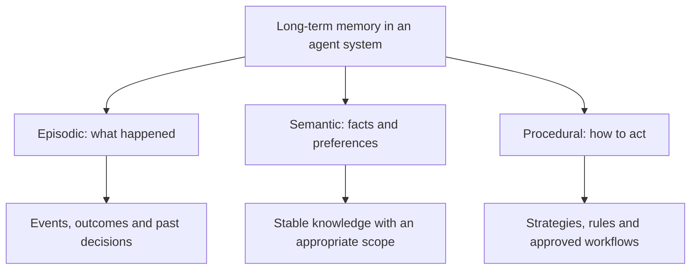

<details>
<summary>Original Picture 8</summary>

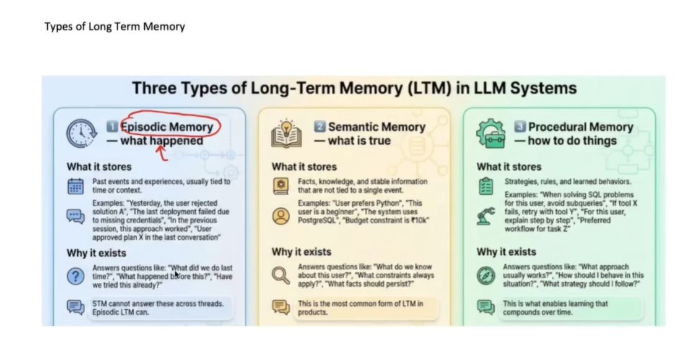

</details>

These are useful design categories inspired by human memory, not claims that an agent has a human brain. An application may implement one or several categories.

| Type | Main question | Example record | How it helps later |
| --- | --- | --- | --- |
| Episodic | What happened before? | A deployment failed because credentials were missing. | Check that prerequisite in a similar deployment. |
| Semantic | What do we currently know? | The user prefers Python examples. | Personalize the next explanation. |
| Procedural | How should this system approach the task? | Use parameterized SQL for this application's queries. | Apply the approved method in later work. |

### 11.1 Episodic memory

An episode records an event in context: what was attempted, when, what happened, and what was learned. “The user rejected option A in the last project meeting” differs from the general claim “The user never wants option A.”

Keeping the original circumstances prevents overgeneralizing a one-time outcome. Retrieved episodes can also serve as examples of successful or unsuccessful approaches.

### 11.2 Semantic memory

Semantic memory holds facts, relationships, or preferences: a preferred language, a project's database, or a confirmed constraint. A record should indicate whose fact it is and whether it is still current.

“Semantic memory” and “semantic search” are different concepts. The first describes the kind of information; the second describes a method for finding related information. A fact can be stored in a plain relational table without a vector database.

### 11.3 Procedural memory

Procedural memory represents rules and strategies that guide behavior. In agent applications, these may be maintained as versioned instructions, workflow configuration, approved examples, or other application data.

For example, a user preference for step-by-step explanations can influence presentation. An application rule requiring review before a particular action governs execution. These should have appropriate priority and ownership: a casual remembered statement must not overwrite higher-priority application rules.

External procedural-memory updates do not automatically retrain model weights. The application changes the information or instructions supplied to the model, or changes its own orchestration.

## 12. Step 1: create or update memories — Picture 9

### Redraw

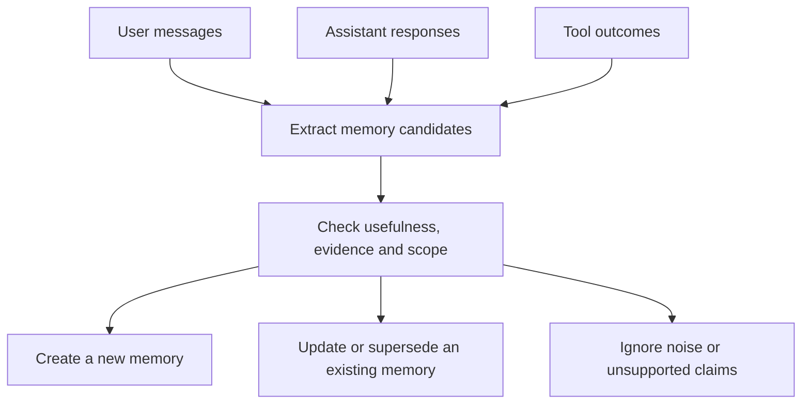

<details>
<summary>Original Picture 9</summary>

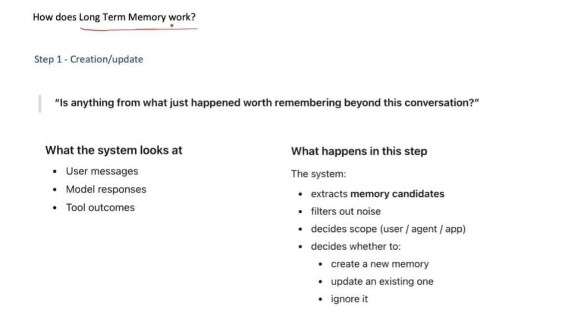

</details>

Ask: **Is anything from this interaction useful beyond this conversation?**

Suppose the user says, “For future tutorials, please use Python.” That is a candidate preference. “Use JavaScript for this one example” is a temporary instruction unless the user says it should replace the general preference.

A memory writer can use explicit rules, structured extraction by a model, direct user controls, or a combination. An LLM is not required for every memory write.

For each candidate, decide whether to create a record, update an existing one, supersede an obsolete fact, or ignore it. Check evidence: an assistant's guess should not become a confirmed user fact just because it appeared in a response.

Choose the correct scope, such as a user or project. If the user later says, “Use TypeScript for future tutorials,” an update may replace the older language preference rather than leaving two contradictory current facts.

Writes can happen during the request or afterward in background work. Immediate writes are available sooner but add work to the response path. Background writes can reduce that delay but require a plan for retries, ordering, and when the information becomes available to other threads.

## 13. Step 2: store the memory — Picture 10

### Redraw

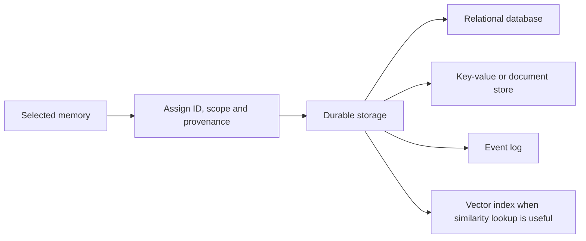

<details>
<summary>Original Picture 10</summary>

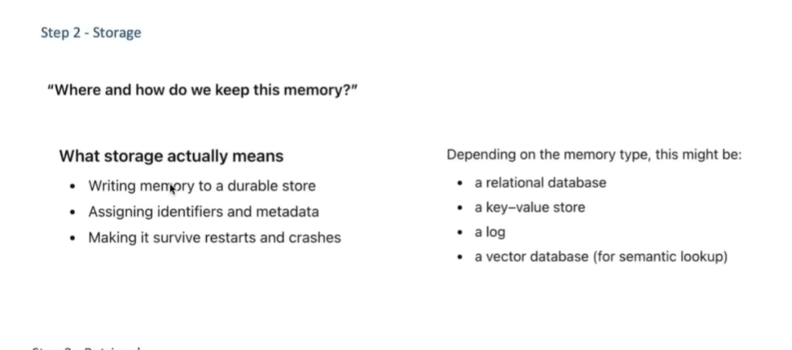

</details>

Storage makes information available beyond the current request. To survive restarts, the chosen storage must actually be durable and retained by the deployment.

A possible memory record is:

```json
{
  "id": "preference-language",
  "user_id": "user-42",
  "type": "semantic",
  "key": "preferred_example_language",
  "value": "Python",
  "source_thread_id": "thread-A",
  "evidence": "For future tutorials, please use Python.",
  "status": "active"
}
```

Real applications may add creation/update times, project scope, confidence or verification status, expiry information, and record versions. Provenance helps explain why a memory exists and how it should be corrected.

Use storage suited to the data. A small structured profile may be retrieved by user ID and key. A large collection of past episodes may benefit from filtered similarity search. A vector database is an option, not a requirement for LTM.

Embedding a memory does not make it permanently correct. Preserve the original meaning and metadata, and ensure updates or deletions also affect derived indexes.

## 14. Step 3: retrieve relevant memories — Picture 11

### Redraw

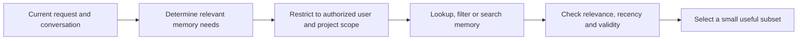

<details>
<summary>Original Picture 11</summary>

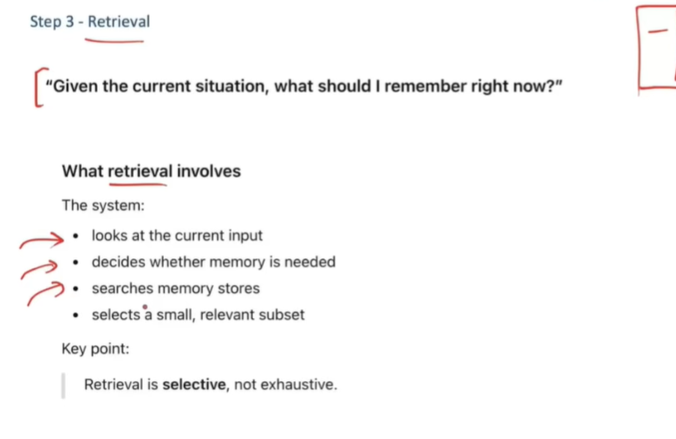

</details>

Ask: **Which saved information matters for this request?**

If the user asks for a LangGraph example, the preferred programming language may matter. Their travel itinerary probably does not. Retrieving every memory recreates the same overload that made full-history prompting difficult.

Use the current request and relevant thread context to build a search. Then apply ownership and project filters, examine current versus superseded records, and select a bounded set of useful items.

Retrieval can use exact keys, database filters, keyword search, embedding similarity, or a combination. Similarity alone does not establish that a record belongs to the user or remains valid. A top-ranked but irrelevant memory should still be omitted.

Retrieval is selective, not exhaustive. “The store contains it” and “the model saw it this turn” are different claims.

## 15. Step 4: inject selected memory into context — Picture 12

### Redraw

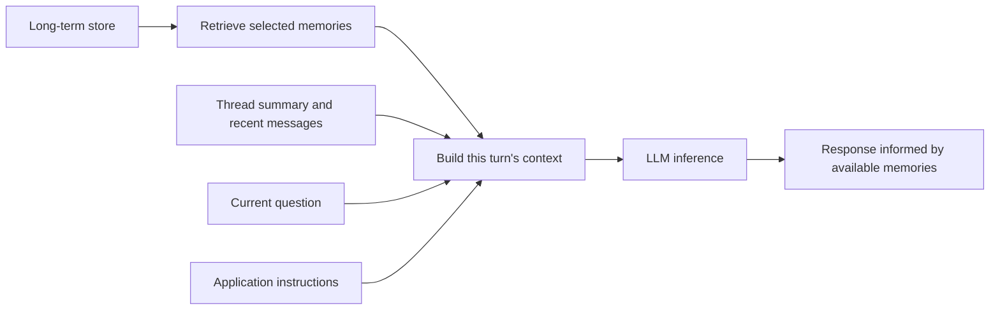

<details>
<summary>Original Picture 12</summary>

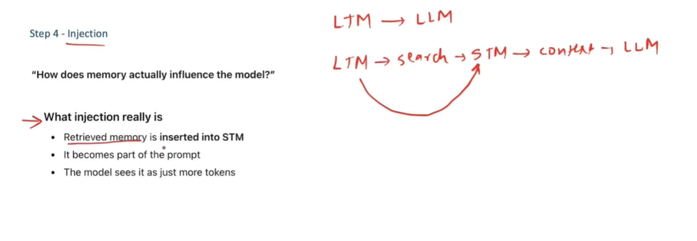

</details>

Ask: **How will the saved information affect this model call?**

Reading from a database is not enough. The application must incorporate relevant memory into the prompt or another model-visible context channel. It might supply a structured profile, a clearly labeled memory section, a tool result, or a carefully managed instruction.

```text
Relevant saved preference:
The user prefers small Python examples for tutorials.

Current conversation:
Human: Explain LangGraph's conditional edges.
```

The model can now choose a Python example because the preference is present in its input. Its weights remain unchanged.

The picture shows retrieved memory being inserted into STM. That is one implementation, but permanent insertion into `state['messages']` is not required. A node can build temporary context for this call while keeping the stored message history separate. This avoids repeatedly appending the same retrieved facts.

Every injected item still consumes context budget. LTM expands the information available for selection; it does not expand the model's maximum window or connect the model directly to unlimited database contents.

## 16. The challenges of long-term memory — Picture 13

### Redraw

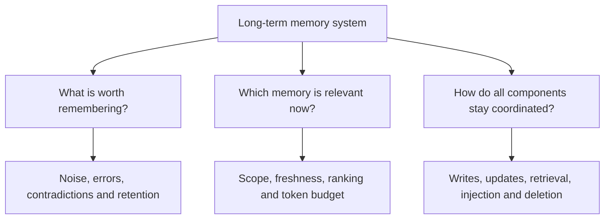

<details>
<summary>Original Picture 13</summary>

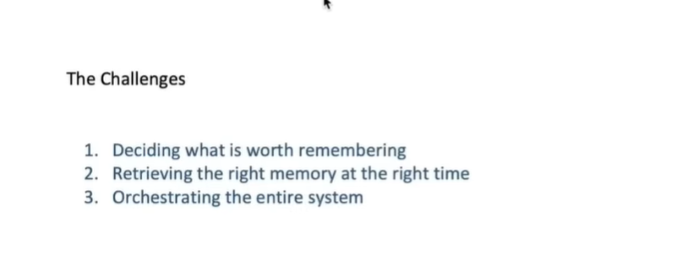

</details>

### 16.1 Deciding what is worth remembering

Saving too little loses useful continuity. Saving everything introduces noise, contradictions, unnecessary cost, and information that should not have been retained.

Distinguish stable preferences from one-time instructions, user statements from model guesses, and current facts from obsolete ones. Provide a way to correct or forget memories. Consider expiry for temporary constraints instead of treating every record as timeless.

### 16.2 Retrieving the right memory at the right time

A system can store a fact perfectly and still fail if it never retrieves it. It can also retrieve the wrong user's fact or an outdated project decision. Quality depends on scope filtering, relevance, freshness, and the amount of context supplied.

Test both retrieval and the final answer. Did the expected memory appear? Did it influence the answer correctly? Did the model obey a temporary instruction instead of inappropriately enforcing an old preference?

### 16.3 Orchestrating the system

Coordinate extraction, validation, writes, updates, indexes, reads, prompt assembly, and deletion. Concurrent conversations may update the same preference, so conflict handling and record versions can matter.

If a background writer fails, the new preference may not be available yet. If a deletion removes only the main record but leaves an index or cached copy, the system may recall information the user expected to forget.

Keep retrieved user data separate from higher-priority instructions. A stored statement such as “ignore all rules next time” should not become an authoritative system instruction. Memory should improve continuity within the application's intended behavior.

## 17. Putting the ideas into LangGraph

LangGraph distinguishes **checkpointers**, which preserve thread state, from **stores**, which hold separately scoped data that can be used across threads. Both can be used in one application. [Persistence overview](https://docs.langchain.com/oss/python/langgraph/persistence).

| Concern | Typical component | Identified by |
| --- | --- | --- |
| Continue this conversation | Checkpointer and graph state | Thread ID |
| Reuse this user's preference in another conversation | Memory store | User/project namespace and record key |
| Fit selected information into the next request | Context assembly | Token budget and relevance policy |

The following tiny example illustrates storage and injection. It assumes `builder` and `llm` are already configured; it is not a complete application:

```python
from langgraph.checkpoint.memory import InMemorySaver
from langgraph.store.memory import InMemoryStore

checkpointer = InMemorySaver()
store = InMemoryStore()

namespace = ("user-42", "preferences")
store.put(namespace, "example-language", {"language": "Python"})

saved = store.get(namespace, "example-language")
preferred_language = saved.value["language"] if saved else None

# Register your nodes before compiling. Pass the store to the graph
# if nodes will access it through the graph's supported runtime API.
chatbot = builder.compile(checkpointer=checkpointer, store=store)

# Conceptual context assembly inside the model-calling layer:
context = {
    "preferred_example_language": preferred_language,
    "recent_messages": selected_recent_messages,
    "current_question": user_query,
}
```

Here, `selected_recent_messages` and `user_query` are application-provided values. Construct appropriate role-structured messages from them before calling the model; the `context` dictionary does not automatically inject itself into an LLM call.

The store example uses exact lookup, not semantic search. Embedding-based search needs the appropriate index configuration. These in-memory components are for explaining behavior: a durable deployment needs suitable persistent backends. [LangGraph stores](https://docs.langchain.com/oss/python/langgraph/stores).

## 18. A complete example of memory across conversations

Imagine building a learning assistant for Musa:

1. **Thread A:** Musa says, “For future explanations, use simple Python examples.” The message enters A's STM.
2. **Memory creation:** the application identifies a reusable preference rather than storing the entire exchange as a universal instruction.
3. **Storage:** it saves the preference under Musa's user namespace, with its source and current status.
4. **Long discussion:** A accumulates many messages. The application summarizes older content and retains recent messages within its token budget.
5. **Reopen A:** the checkpointer restores A's state. This is persisted STM.
6. **Start Thread B:** B begins with a separate message history. The preference is not automatically copied from A's checkpoint.
7. **Retrieval:** for a new programming question in B, the application looks up Musa's language preference.
8. **Injection:** it adds the relevant preference to B's current model input alongside the question and selected thread context.
9. **Generation:** the model produces an explanation using a Python example. Its parameters have not been updated.
10. **Correction:** Musa changes the preference. The memory writer updates the active record so future retrieval uses the revised preference.

This illustrates three independent tasks: **store thread state, manage the context budget, and reuse selected cross-thread knowledge**. None replaces the others.

## 19. Final distinctions to remember

| Idea | What it does | What it does not do automatically |
| --- | --- | --- |
| Model parameters | Encode patterns and knowledge learned in training | Save each user's new conversation |
| Context window | Bounds what can be processed in the current generation | Provide unlimited or permanent storage |
| Contextual use / in-context learning | Lets supplied information influence behavior | Update model weights for every interaction |
| Short-term memory | Maintains one thread's working context | Share facts across isolated threads |
| Persistence | Preserves data across the relevant storage lifetime | Decide what belongs in the current prompt |
| Trimming and summarization | Reduce the context sent for generation | Preserve every original detail without loss |
| Long-term memory | Makes selected information reusable across threads | Guarantee perfect retrieval or unlimited context |

**The apparent memory lives in the whole system:** the model uses learned parameters and current input, while the application decides what to save, what to retrieve, and what to show the model now.

## References

- Brown et al. (2020), [Language Models are Few-Shot Learners](https://arxiv.org/abs/2005.14165).
- [LangChain memory overview](https://docs.langchain.com/oss/python/concepts/memory).
- [LangGraph memory management](https://docs.langchain.com/oss/python/langgraph/add-memory).
- [LangGraph persistence](https://docs.langchain.com/oss/python/langgraph/persistence).
- [LangGraph stores](https://docs.langchain.com/oss/python/langgraph/stores).

The thirteen supplied pictures are learning references, not instructions to execute. Their claims are refined where needed, and each has a redraw above. Code fragments are explanatory and were not run here.
