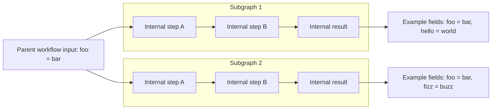
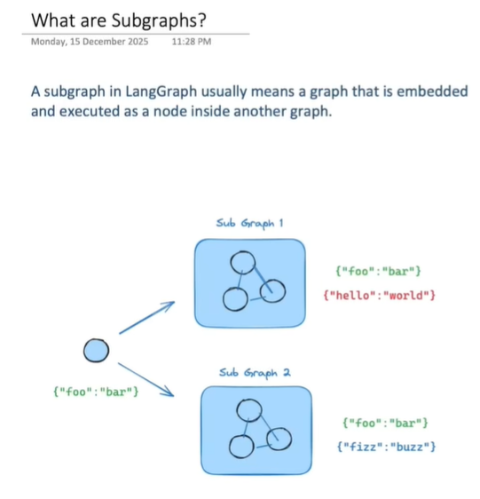
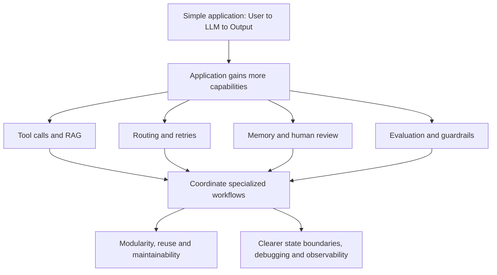
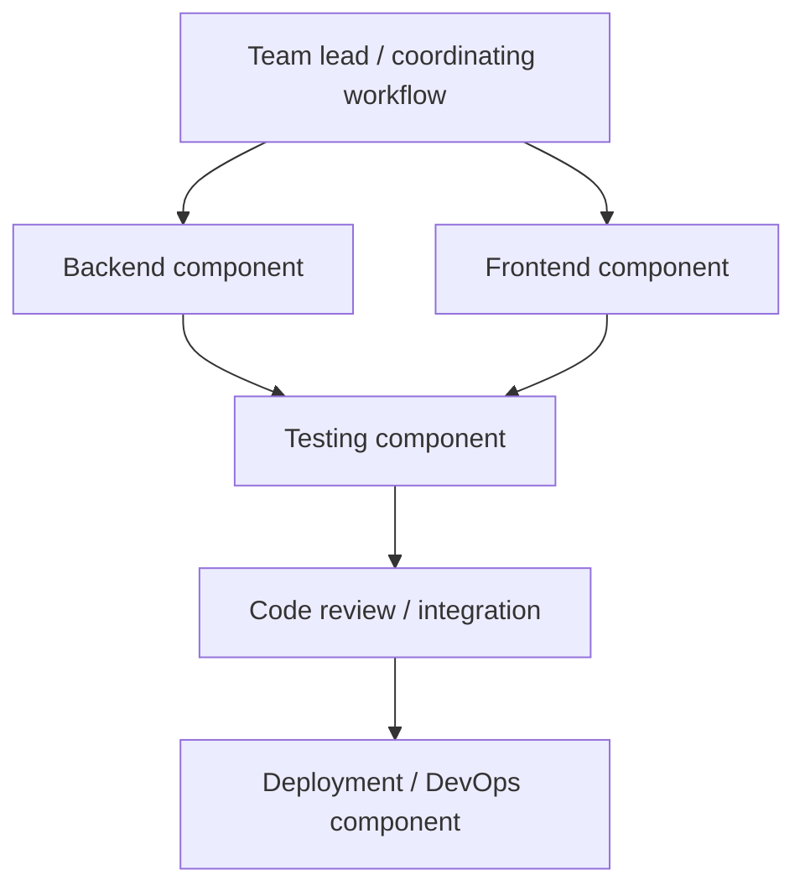
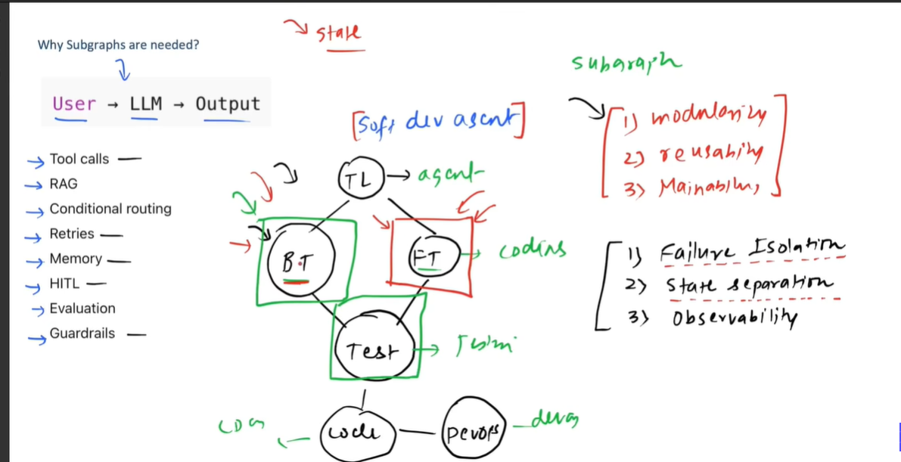
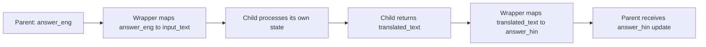
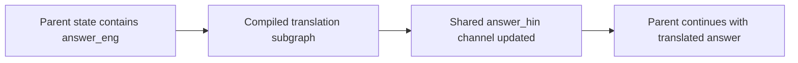

# Subgraphs in LangGraph

## 1. Draw Picture 1: a graph inside another graph





### What is a subgraph?

A **subgraph** is a graph used as a component inside another graph. The outer graph is called the **parent graph**, and the embedded workflow is the **child graph** or subgraph.

From the parent's perspective, a subgraph can appear as one workflow step. Inside that step, it can have its own nodes, edges, branching, and state schema.

```text
Parent view:
Receive request -> research component -> compose answer

Inside the research component:
Prepare query -> search documents -> assess results -> return evidence
```

A subgraph does not need to contain an LLM. It can coordinate ordinary Python functions, tools, model calls, or a mixture.

### What does the first picture show?

The parent supplies a value such as `foo = bar` to two child workflows. Each child has internal processing and can work with additional fields, illustrated as `hello = world` and `fizz = buzz`.

The lesson is that a parent can coordinate several specialized workflows without flattening every internal node into its own top-level diagram.

The picture's displayed fields do not mean that every child-private field automatically becomes part of parent state. What crosses the boundary depends on shared state channels or explicit input/output mapping. We will examine both patterns below. [Official subgraph guide](https://docs.langchain.com/oss/python/langgraph/use-subgraphs).

## 2. Draw Picture 2: why larger applications need structure

The second picture combines three ideas: growing application complexity, a software-development team analogy, and benefits of modular workflows. The redraw separates them so the relationships are easier to read.







The second diagram is a conceptual interpretation of the handwritten team sketch, not a requirement to build a particular multi-agent system. Its point is delegation: a coordinator organizes specialized work, while each component manages its own internal steps.

### 2.1 From a simple model call to a complex application

An application may begin with one model call. Later, it needs document retrieval, tool execution, retries, state restoration, approval, testing, and output checks. Putting all of that logic into a single graph can create a diagram that is hard to understand and change.

For example, a development assistant may need to interpret requirements, generate backend code, generate frontend code, test their interaction, review the result, and prepare deployment instructions. Each responsibility can itself require several steps.

Subgraphs let the parent express the high-level process while each child expresses the details of one responsibility.

### 2.2 Modularity

Group related work behind an understandable interface. A testing subgraph can contain test preparation, execution, result analysis, and a retry decision. The parent can treat it as the testing component rather than managing each internal operation directly.

### 2.3 Reusability

A component can be reused when several workflows need the same capability. A document-analysis subgraph might support both a question-answering assistant and a report-writing assistant, provided each caller supplies the required input and handles the result.

Reuse works best when the interface expresses the component's task rather than assumptions about one specific parent.

### 2.4 Maintainability and independent development

Developers can work on separate components and test their behavior against agreed interfaces. A change inside the research component need not require rewriting the parent's orchestration if the input/output contract remains compatible.

This is a design benefit, not a guarantee: changing a shared field's meaning or return format can still break callers.

### 2.5 Failure isolation

A well-defined component makes it easier to identify where a failure happened and where recovery should be handled. A testing failure can be understood as a testing-component failure instead of an unexplained failure somewhere in a huge workflow.

However, **a subgraph is not automatically a separate process, transaction, or failure sandbox**. An unhandled exception can still propagate and fail the parent execution. Retries, error handling, checkpointing, and idempotent operations need their own design.

### 2.6 State separation

An agent may need its own working messages, intermediate search results, or scratch fields. Keeping those inside a child can reduce unnecessary coupling to parent state.

“Private state” here means an interface boundary. It does not automatically mean encrypted data, a security boundary, or information hidden from logs and traces.

### 2.7 Observability

Nested execution makes it easier to investigate which component took time, which internal step failed, or what a specialized workflow returned. Instrumentation and suitable tracing make that structure useful; merely creating a subgraph does not configure a monitoring system.

## 3. Two ways to integrate a subgraph

| Pattern | What you register as the parent node | How state crosses the boundary |
| --- | --- | --- |
| Invoke the subgraph inside a node | A wrapper function | Explicitly map parent input to child input and child output back to parent updates. |
| Add the subgraph directly as a node | The compiled subgraph | Use compatible shared state keys/channels. |

The first is especially useful for separate schemas or transformations. The second is convenient when the parent and child already agree on the keys they exchange.

These are integration patterns, not rigid restrictions. A wrapper can be useful even when some keys overlap, and a directly added child can have private fields in addition to shared ones. The schemas do not have to be completely identical for direct insertion.

## 4. Pattern A: invoke a subgraph from a wrapper node

### 4.1 The idea: an adapter between separate schemas

Suppose the parent stores an English answer under `answer_eng`, but the child expects its input under `input_text`. Their field names differ, so an adapter maps between them.



The central pattern is:

```python
def translate_answer(state):
    result = subgraph.invoke({"input_text": state["answer_eng"]})
    return {"answer_hin": result["translated_text"]}


parent_builder.add_node("translate", translate_answer)
```

This is an integration fragment. `subgraph` must already be compiled, and `parent_builder` must be defined.

### 4.2 What is separate?

The parent may have `question`, `answer_eng`, and `answer_hin`. The child may have `input_text`, `translated_text`, and internal review fields. The wrapper deliberately chooses which data enters and which result is exported.

The parent does not automatically receive every key returned by the child. It receives the update returned by the wrapper.

### 4.3 Complete example without a model or API key

To make the state mapping easy to test, this example uses a two-step text-formatting subgraph rather than pretending a fixed string is an actual translation.

```python
from typing import TypedDict
from langgraph.graph import END, START, StateGraph


class ChildState(TypedDict):
    raw_text: str
    cleaned_text: str
    formatted_text: str


def clean_text(state: ChildState):
    return {"cleaned_text": " ".join(state["raw_text"].split())}


def format_text(state: ChildState):
    return {"formatted_text": state["cleaned_text"].upper()}


child_builder = StateGraph(ChildState)
child_builder.add_node("clean", clean_text)
child_builder.add_node("format", format_text)
child_builder.add_edge(START, "clean")
child_builder.add_edge("clean", "format")
child_builder.add_edge("format", END)
child = child_builder.compile()


class ParentState(TypedDict):
    draft: str
    final_text: str


def call_formatter(state: ParentState):
    child_result = child.invoke({"raw_text": state["draft"]})
    return {"final_text": child_result["formatted_text"]}


parent_builder = StateGraph(ParentState)
parent_builder.add_node("formatter", call_formatter)
parent_builder.add_edge(START, "formatter")
parent_builder.add_edge("formatter", END)
parent = parent_builder.compile()

result = parent.invoke({"draft": "  hello    subgraphs  "})
assert result["final_text"] == "HELLO SUBGRAPHS"
assert "cleaned_text" not in result
print(result)
```

Expected parent result:

```text
{'draft': '  hello    subgraphs  ', 'final_text': 'HELLO SUBGRAPHS'}
```

The child's internal cleaning field is not exported. The wrapper maps `draft` to `raw_text` and maps `formatted_text` back to `final_text`.

### 4.4 When to choose a wrapper

Use this pattern when schemas differ, values need conversion, a reusable child should not know the parent's field names, or only selected fields should cross the boundary. It is also useful when a specialized agent needs its own message format or working history.

A wrapper adds mapping code. Keep that mapping explicit and test it, especially when the child interface changes. A separate schema does not itself create durable private memory; persistence configuration is a separate choice.

## 5. Pattern B: insert the compiled subgraph as a node

### 5.1 The idea: communicate through shared keys

If the parent and child agree on the relevant channels, pass the compiled child directly to `add_node`:

```python
parent_builder.add_node("translate", subgraph)
```

For the translation example, both can use `answer_eng` as input and `answer_hin` as output. No wrapper is needed to rename those fields.



“Shared state” means communication through compatible graph-state channels. Avoid thinking of it as unrestricted mutation of one global Python dictionary. Nodes return updates that the runtime applies according to the state schema and reducers. [Graph state and reducers](https://docs.langchain.com/oss/python/langgraph/graph-api).

### 5.2 Complete example with shared and private fields

This example performs the same cleaning/formatting task, but communicates through a shared `text` key. The child also uses a private intermediate field.

```python
from typing import TypedDict
from langgraph.graph import END, START, StateGraph


class ParentState(TypedDict):
    text: str


class ChildState(TypedDict):
    text: str
    cleaned_text: str


def clean_text(state: ChildState):
    return {"cleaned_text": " ".join(state["text"].split())}


def format_text(state: ChildState):
    return {"text": state["cleaned_text"].upper()}


child_builder = StateGraph(ChildState)
child_builder.add_node("clean", clean_text)
child_builder.add_node("format", format_text)
child_builder.add_edge(START, "clean")
child_builder.add_edge("clean", "format")
child_builder.add_edge("format", END)
child = child_builder.compile()

parent_builder = StateGraph(ParentState)
parent_builder.add_node("formatter", child)
parent_builder.add_edge(START, "formatter")
parent_builder.add_edge("formatter", END)
parent = parent_builder.compile()

result = parent.invoke({"text": "  hello    subgraphs  "})
assert result == {"text": "HELLO SUBGRAPHS"}
print(result)
```

Expected parent result:

```text
{'text': 'HELLO SUBGRAPHS'}
```

The shared key is `text`. The child reads it, computes an internal `cleaned_text`, and writes the formatted value back through `text`. The parent does not acquire the child-only field just because the child used it.

### 5.3 When to choose direct insertion

Use this pattern when the parent and child already share compatible input/output keys and the values have the same meaning. It reduces adapter code and makes composition straightforward.

A common example is agents intentionally communicating through a shared `messages` channel. Sharing all conversation messages is a design choice; it is not automatically the best choice for every specialized agent.

## 6. Which approach should I use?

| Question | Prefer a wrapper node | Prefer direct insertion |
| --- | --- | --- |
| Do field names differ? | Map between the names. | Appropriate if names already match. |
| Do values need conversion or validation at the boundary? | Put that work in the adapter. | Convenient when no mapping is needed. |
| Should the child be reusable across parents with different schemas? | A stable child interface works well. | Works when callers adopt the same channels. |
| Are shared message channels intentional? | Useful if messages need filtering or conversion. | Useful when both components should exchange the same channel. |
| Can the child have private intermediate fields? | Yes. | Yes, alongside shared keys. |

Choose based on the **communication contract**, not just the number of nodes. A large subgraph can use shared channels, and a small subgraph can benefit from a separate interface.

## 7. How the notebooks in this folder demonstrate the patterns

### Separate schemas: 15_subgraphs.ipynb

[15_subgraphs.ipynb](15_subgraphs.ipynb) defines a child with `input_text` and `translated_text`. Its parent uses `question`, `answer_eng`, and `answer_hin`.

The parent first generates an English answer. Its `translate_answer` wrapper passes that answer as `input_text`, invokes the child, and returns the child's translated output under `answer_hin`.

```text
question -> parent generates answer_eng
         -> wrapper sends input_text to translation subgraph
         -> child returns translated_text
         -> wrapper updates answer_hin
```

### Shared schema: 15_subgraph_shared.ipynb

[15_subgraph_shared.ipynb](15_subgraph_shared.ipynb) uses `ParentState` for both parent and child. The translation child reads `answer_eng` and updates `answer_hin`, so the parent registers it directly as its `translate` node.

```text
question -> parent generates answer_eng
         -> compiled translation subgraph reads answer_eng
         -> shared answer_hin field updated
```

The notebooks demonstrate the same task with different interfaces. Their model calls require the corresponding provider setup. The smaller examples above avoid that dependency so the state exchange is easier to understand.

## 8. Important implementation details

### Compile the child before registering or invoking it

The builder defines the workflow; the compiled graph is what you execute or insert into another graph. Register the compiled child, not an unfinished builder.

### Agree on field meaning as well as names

Two keys both named `text` are not truly compatible if one contains a search query and the other expects a finished report. Write down the interface in terms of required inputs, returned outputs, and expected types.

### Plan reducers for concurrent updates

The first picture branches to two children. If both branches update the same parent key during the same step, the parent needs an appropriate merge design, such as separate output fields or a suitable reducer. A subgraph does not automatically resolve competing updates.

### Keep memory and composition separate

A subgraph is a workflow boundary. Checkpointing determines how execution state is saved, and its persistence settings influence whether child state is reused or isolated across calls. Do not assume that separate schemas automatically create persistent independent conversations.

### Handle failures deliberately

Checkpointing can help preserve progress, but operations that may be retried or replayed need suitable handling of side effects. A failed subgraph should not silently appear to have produced a valid result. [Persistence overview](https://docs.langchain.com/oss/python/langgraph/persistence).

## 9. The main idea

**Use subgraphs to organize specialized workflows behind clear interfaces.** Invoke a child inside a wrapper when you need explicit mapping or separation; add it directly as a node when compatible state channels already provide the intended communication.

## References and validation

- [Official LangGraph subgraph guide](https://docs.langchain.com/oss/python/langgraph/use-subgraphs).
- [Graph API: state, nodes, edges and reducers](https://docs.langchain.com/oss/python/langgraph/graph-api).
- [LangGraph persistence](https://docs.langchain.com/oss/python/langgraph/persistence).

Both supplied pictures are embedded as references and redrawn above. Python examples were checked for syntax but not executed here because LangGraph is not installed in the bundled verification environment. The existing notebooks are unchanged.
