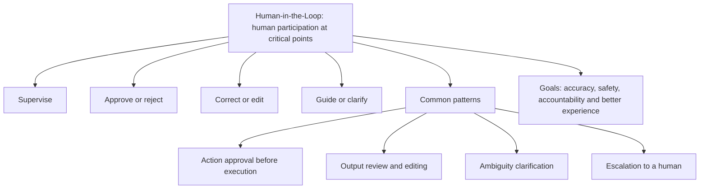
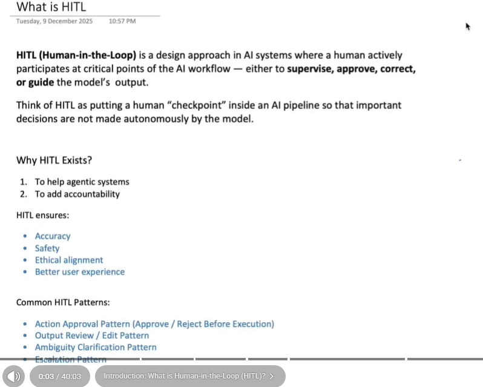
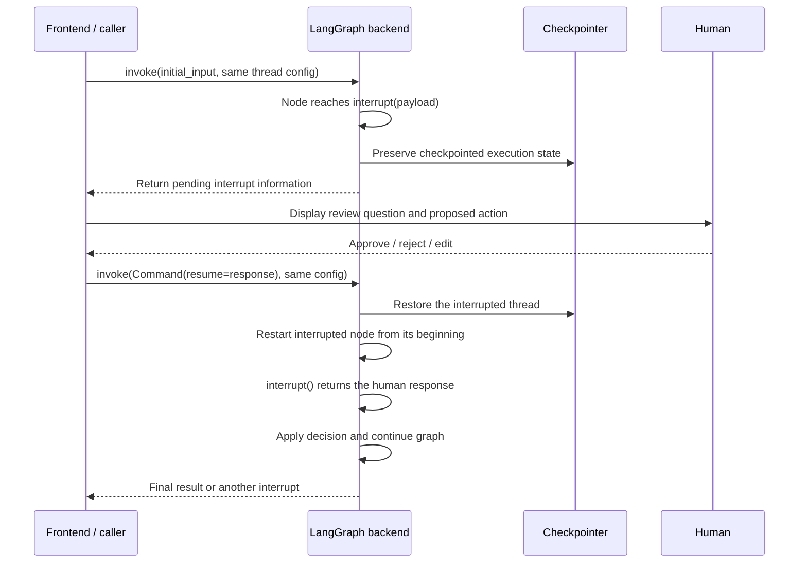

# Human-in-the-Loop (HITL) in LangGraph

## 1. Draw the ideas from the picture





**Human-in-the-Loop (HITL)** means a human participates at selected points in an AI workflow to approve, reject, correct, or guide what happens next. The application intentionally asks for input instead of letting the model complete every decision autonomously.

For example, an assistant might draft a customer email but wait for approval before sending it. A reviewer can approve the draft, reject it, or provide an edit. The workflow then follows the appropriate branch.

The picture describes human involvement as a “checkpoint.” That is a useful everyday analogy. In LangGraph, a **checkpoint** has a more specific meaning: saved graph state. The human review point is an **interrupt**, supported by checkpointing.

The benefits in the picture are goals, not guarantees. A reviewer needs enough information to make a meaningful decision; simply adding an approval button does not ensure correctness.

## 2. The complete pause-and-resume flow



The first invocation runs until it completes or pauses. If it pauses, control returns to the caller so the interface can ask the human for input. A later invocation resumes the existing interrupted execution.

## 3. Where do we implement HITL?

Place an `interrupt()` call inside the node whose work needs human input, at the point before that input is used. It can also be placed inside a tool executed as part of the graph.

```python
from langgraph.types import interrupt


def review_node(state):
    decision = interrupt(
        {
            "question": "Do you approve this draft?",
            "draft": state["draft"],
        }
    )
    # This part can use the resume value after human input arrives.
    return {"approved": decision["approved"]}
```

Here, `decision` is a normal Python variable chosen by the developer. It is not a special LangGraph keyword. We could call it `human_response` instead.

## 4. What is interrupt()?

`interrupt()` is LangGraph's function for requesting external input during graph execution. It accepts a JSON-serializable payload, such as a string or dictionary. The payload describes what the caller should show or ask.

On the initial pass, the function triggers a pause instead of returning an ordinary decision. When resumed with a response, that response becomes the function's return value. [Official interrupt documentation](https://docs.langchain.com/oss/python/langgraph/interrupts).

Think of the same line in two phases:

```python
decision = interrupt({"question": "Approve this action?"})
```

```text
First invocation:
    expose the question and pause
    no approval result is available yet

Resumed invocation:
    interrupt returns the supplied human response
    decision receives that response
```

The question sent outward and the response received back are separate values. Sending a dictionary question does not force the response to be a dictionary; the frontend/backend contract determines its expected shape.

## 5. Checkpointing and thread IDs keep the workflow connected

A dynamic interrupt needs a checkpointer and a thread ID. The checkpointer preserves execution state; the thread ID selects which execution is paused and resumed.

```python
from langgraph.checkpoint.memory import InMemorySaver

checkpointer = InMemorySaver()
chatbot = builder.compile(checkpointer=checkpointer)
config = {"configurable": {"thread_id": "review-chat-123"}}
```

For a temporary example, the saver can live in RAM. It must remain the same live instance between the initial call and resume. Restarting the process loses in-memory checkpoints. A database-backed saver is appropriate when a human may return after an application restart or through another worker.

The backend must reconnect to the same preserved database and reuse the same thread ID. Generating a new UUID when the human presses Approve would select a different thread rather than the paused one.

Checkpointing preserves graph state and execution information, not every Python local variable or an entire operating-system process image. Return important data through state updates and structure the workflow around replay-safe steps.

## 6. How does the frontend receive the interrupt?

With the default `invoke()` pattern used here:

```python
result = chatbot.invoke(initial_input, config=config)
pending = result.get("__interrupt__", [])

if pending:
    question_payload = pending[0].value
    # Render this value in the UI and wait for the user's response.
```

`pending[0]` is an interrupt object; `.value` contains the payload supplied to `interrupt()`. These examples assume one pending approval request. Multiple simultaneous interrupts require pairing responses with their interrupt IDs.

LangGraph returns the information to its caller. A web application backend then forwards a serialized representation to its frontend; LangGraph does not automatically create approval buttons or send a browser notification.

A useful interface displays the proposed action, its important details, and Approve/Reject controls. It retains the corresponding thread ID while waiting. A pause should be shown as “waiting for review,” rather than as a completed answer.

## 7. What is Command?

`Command` is a LangGraph control object. In this workflow, **`Command(resume=value)` tells the runtime to supply external input to a pending interrupt**.

```python
from langgraph.types import Command

result = chatbot.invoke(
    Command(resume={"approved": True}),
    config=config,
)
```

This is different from sending a new chat message:

```text
Normal turn:
    invoke({"messages": [new_user_message]}, config)

Resume pending review:
    invoke(Command(resume=human_response), config)
```

For node implementations, `Command` can also express state updates and routing decisions. Those uses are separate from passing `Command(resume=...)` to resume an interrupted invocation. [Graph API reference guide](https://docs.langchain.com/oss/python/langgraph/graph-api).

## 8. Dictionary responses: decision['approved']

Suppose the frontend sends:

```python
human_input = "yes"
chatbot.invoke(Command(resume={"approved": human_input}), config=config)
```

The node's `interrupt()` returns:

```python
{"approved": "yes"}
```

Therefore, the decision variable is a dictionary:

```python
decision = interrupt({"question": "Approve the draft?"})

if decision["approved"] == "yes":
    return {"status": "approved"}
else:
    return {"status": "rejected"}
```

Use the key because the response contains a field named `approved`. The field name has no automatic meaning to LangGraph; both sides agreed to use it.

For a boolean contract, the frontend can send:

```python
Command(resume={"approved": True})
```

Then the backend checks a boolean, not the string `"yes"`:

```python
if decision["approved"] is True:
    return {"status": "approved"}
```

Do not use the truthiness of arbitrary strings: both `"yes"` and `"no"` are nonempty strings and therefore truthy in Python. Validate the expected shape and type before using it for an action.

## 9. String responses: decision == 'yes'

If the frontend instead sends:

```python
chatbot.invoke(Command(resume="yes"), config=config)
```

the return value is a string:

```python
decision = interrupt("Approve the draft? Reply yes or no.")

if isinstance(decision, str) and decision.strip().lower() == "yes":
    return {"status": "approved"}
else:
    return {"status": "rejected"}
```

There is no `approved` key in this response, so `decision["approved"]` would be incorrect.

| Value passed to resume | Value assigned to decision | Appropriate check |
| --- | --- | --- |
| `"yes"` | String | `decision == "yes"` after normalization |
| `{"approved": "yes"}` | Dictionary containing a string | `decision["approved"] == "yes"` |
| `{"approved": True}` | Dictionary containing a boolean | `decision["approved"] is True` |
| `True` | Boolean | `decision is True` |

The response format determines how the backend accesses it. Choose one contract and use it consistently. Invalid or missing input should be rejected or requested again, rather than silently treated as approval.

## 10. What does “continue where it left off” mean?

Logically, the graph continues its paused workflow with preserved thread state. Mechanically, **the interrupted node starts again from its beginning**. Code before `interrupt()` runs again; at the interrupt call, the runtime supplies the saved resume response, and execution can proceed beyond it.

```python
def review_node(state):
    print("Preparing review")  # Can run again on resume.
    decision = interrupt({"question": "Approve?"})
    print("Response received:", decision)
    return {"approved": decision["approved"]}
```

This is not ordinary Python execution frozen with its stack waiting inside the function. Avoid non-idempotent actions before the interrupt. For example, do not send an email and then ask whether it should be sent: replay could repeat the send, and approval came too late anyway.

Use a separate node to prepare a draft and return it into graph state, then review that saved draft in another node. This avoids regenerating an expensive or changing proposal before the same approval request.

The local `decision` variable is not automatically added to graph state. Return it, or selected fields from it, in a state update if it needs to be retained after the node finishes.

## 11. Complete example without an LLM or API key

This example demonstrates the mechanics with a simulated publish action. It does not publish anything externally.

```python
from typing import TypedDict

from langgraph.checkpoint.memory import InMemorySaver
from langgraph.graph import END, START, StateGraph
from langgraph.types import Command, interrupt


class ReviewState(TypedDict):
    draft: str
    approved: bool
    status: str


def review(state: ReviewState):
    decision = interrupt(
        {
            "question": "Approve publishing this draft?",
            "draft": state["draft"],
            "expected_response": {"approved": "boolean"},
        }
    )
    if not isinstance(decision, dict):
        raise ValueError("Expected a dictionary response")
    if type(decision.get("approved")) is not bool:
        raise ValueError("approved must be a boolean")
    return {"approved": decision["approved"]}


def choose_branch(state: ReviewState):
    return "publish" if state["approved"] else "cancel"


def publish(state: ReviewState):
    return {"status": "Approved: simulated publication completed"}


def cancel(state: ReviewState):
    return {"status": "Rejected: nothing published"}


builder = StateGraph(ReviewState)
builder.add_node("review", review)
builder.add_node("publish", publish)
builder.add_node("cancel", cancel)
builder.add_edge(START, "review")
builder.add_conditional_edges(
    "review", choose_branch, {"publish": "publish", "cancel": "cancel"}
)
builder.add_edge("publish", END)
builder.add_edge("cancel", END)

chatbot = builder.compile(checkpointer=InMemorySaver())
config = {"configurable": {"thread_id": "hitl-demo-1"}}

result = chatbot.invoke(
    {"draft": "Welcome to our course!", "approved": False, "status": "pending"},
    config=config,
)

pending = result.get("__interrupt__", [])
if pending:
    print("Review request:", pending[0].value)

    # Represents the response collected by an interface.
    human_response = {"approved": True}
    result = chatbot.invoke(Command(resume=human_response), config=config)

print(result["status"])
```

The `expected_response` field in the prompt payload is descriptive information, not automatic validation. This example validates the resumed data explicitly in Python.

Changing the response to `{"approved": False}` selects the cancellation branch. The initial invocation uses state input; the second uses a resume command with the same config and live saver.

## 12. Frontend handling across repeated pauses

A real workflow can interrupt more than once. After every initial or resumed invocation, inspect its result again:

```text
Receive graph result
    -> pending interrupt? display review UI and wait
    -> human responds? resume same thread with Command
    -> inspect new result
    -> another interrupt? repeat
    -> otherwise display completed result
```

A web UI should retain the pending request and selected thread across rerenders. It should not automatically resume with a default answer when the user has not submitted one. Match approval to the displayed proposal so a delayed click does not approve unrelated work.

For multiple pending interrupts, retain their identifiers and follow the runtime's ID-based response mapping rather than blindly approving only the first item. These notes use a single interrupt to keep the core flow clear.

## 13. How this relates to the existing chatbot

[chatbot_with_hitl.py](chatbot_with_hitl.py) places `interrupt()` inside a `purchase_stock` tool. That tool simulates a purchase; it does not place an actual trade.

```text
User request -> chat_node -> model requests purchase_stock
    -> ToolNode invokes tool -> interrupt asks for approval
    -> caller collects a string -> Command(resume=decision)
    -> resumed tool checks that string
    -> tool returns success/cancellation data
    -> chat_node interprets the result -> final answer
```

Its decision check expects a string such as `"yes"`. Sending `{"approved": True}` would require changing the tool's matching logic accordingly. A dictionary is not interchangeable with a string just because both represent approval.

The existing CLI handles one approval after the first invocation. A workflow that may pause again should recheck for interrupts after every resume. The existing backend is unchanged by these notes.

## 14. Common mistakes

| Mistake | Why it causes trouble | Correct approach |
| --- | --- | --- |
| No checkpointer | Paused execution lacks the required persistence mechanism. | Compile with a suitable saver. |
| New thread ID on approval | The response targets a different thread. | Reuse the interrupted thread ID. |
| Send a normal chat message instead of Command | It is not the intended interrupt response path. | Use `Command(resume=...)`. |
| Compare a dictionary with `"yes"` | The formats do not match. | Read its agreed field. |
| Use `if decision['approved']` with string `"no"` | Nonempty strings are truthy. | Normalize and compare, or use a boolean contract. |
| Perform an irreversible action before approval | It occurs before the decision and may repeat on replay. | Review first and design actions for retries. |
| Catch the interrupt with a broad exception handler | Interrupts use special control flow. | Keep interrupt calls outside broad catches or propagate interrupts correctly. |
| Assume local variables are persisted automatically | Graph checkpoints are not Python stack snapshots. | Return important results into graph state. |

Keep multiple interrupt calls within a node in a stable order, because replay must match resume values to the intended calls. For complex review processes, separate review steps into clear nodes.

## 15. The main idea

**Pause with `interrupt(payload)`, show the payload to a human, resume the same thread with `Command(resume=response)`, and handle that response using the format you agreed on.** The checkpoint preserves the workflow's state, while your decision logic determines the approved or rejected path.

## References

- [LangGraph interrupts: pause, resume, and replay behavior](https://docs.langchain.com/oss/python/langgraph/interrupts)
- [LangGraph Graph API and Command](https://docs.langchain.com/oss/python/langgraph/graph-api)

The examples are instructional and have not been executed here. The supplied picture is included as a reference, and the diagrams redraw its concepts and the implementation flow.
