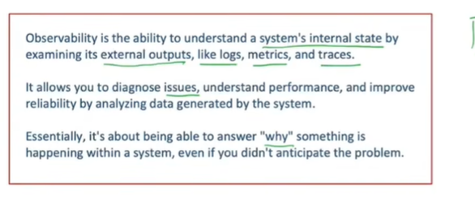
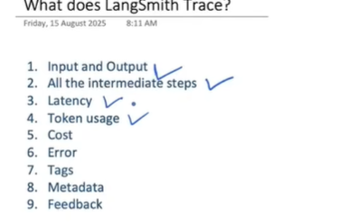
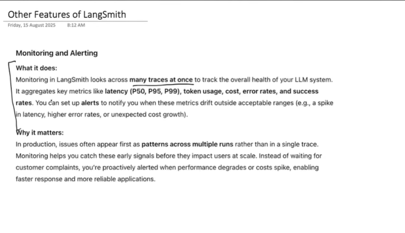
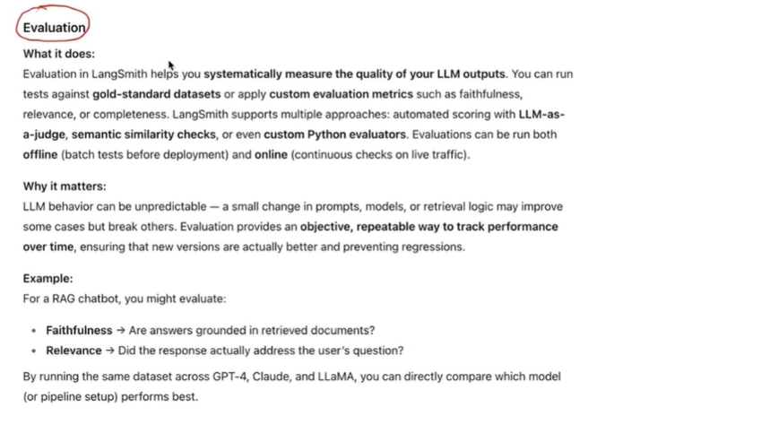
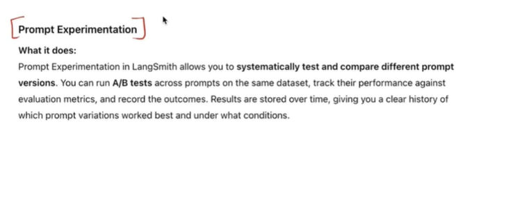
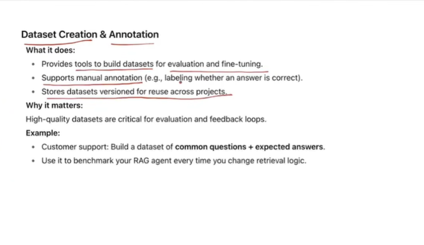
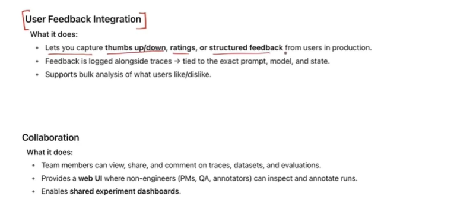

# LangSmith: Detailed Learning Notes

These notes explain why LangSmith is useful, introduce observability, define LangSmith, and walk through tracing and the additional features shown in the seven supplied pictures. The pictures are reference material; the explanations expand their ideas with practical examples and qualifications.

## Contents

1. [Why do we need LangSmith?](#1-why-do-we-need-langsmith)
2. [What is observability? — Picture 1](#2-what-is-observability--picture-1)
3. [Formal definition of LangSmith](#3-formal-definition-of-langsmith)
4. [What does LangSmith trace? — Picture 2](#4-what-does-langsmith-trace--picture-2)
5. [Additional features — Pictures 3–7](#5-additional-features--pictures-37)
6. [An end-to-end improvement workflow](#6-an-end-to-end-improvement-workflow)
7. [References](#7-references)

## 1. Why do we need LangSmith?

### 1.1 An LLM application has more moving parts than its final answer reveals

Consider a customer-support assistant built with LangGraph. A user asks whether a purchase qualifies for a refund. The application may classify the request, retrieve a policy, query an order tool, call an LLM, check the answer, and possibly retry before returning a response.

```text
User question
    -> classify request
    -> retrieve policy documents
    -> look up order details
    -> build prompt
    -> call model
    -> validate answer / retry if necessary
    -> final response
```

If the assistant gives the wrong refund policy, the final answer alone does not identify the cause. The retrieved policy may be outdated, the order tool may return the wrong record, the prompt may omit an important condition, or the model may ignore the evidence. Each problem needs a different fix.

LangSmith provides a place to inspect the recorded execution and connect a visible symptom to the step that caused it. Its observability offering supports examining model calls, retrieved context, tool use, timing, and quality signals. [Official observability overview](https://www.langchain.com/langsmith/observability).

### 1.2 Successful execution does not guarantee a good answer

A Python function can finish without an exception while the model produces an irrelevant, unsupported, or incomplete answer. An HTTP success response tells us the request was processed; it does not establish that the user's problem was solved.

For example, an assistant may confidently say that every product has a 30-day refund window when a particular product is non-refundable. There is no technical crash, but there is a quality failure. We need a way to examine what the model received and separately measure whether its response was appropriate.

### 1.3 Agent paths can vary between requests

An agent may choose different tools or repeat a step depending on the input and previous results. A LangGraph workflow may branch, loop, or run independent nodes in parallel. Looking only at the final response hides this execution path.

Suppose one request completes quickly while a similar request takes much longer. The slow request might have performed three retrieval attempts and two model retries. A trace can reveal these recorded steps and their timing. That evidence is more useful than guessing that the model is simply slow.

### 1.4 Latency and cost need to be explained

A large prompt, unnecessary model call, repeated tool invocation, or retry loop can increase resource use. We want to answer questions such as:

- Which step consumed most of the response time?
- Are we sending irrelevant document chunks into the prompt?
- Does the more expensive model actually improve answer quality?
- Did a recent change increase the number of calls per request?

Token and cost records help investigate usage, while timing records help locate bottlenecks. Cost visibility depends on the usage and pricing information available to LangSmith; it should not be treated as a complete infrastructure bill. [Cost tracking documentation](https://docs.langchain.com/langsmith/cost-tracking).

### 1.5 Changes need evidence before release

A prompt that works better on one example may perform worse on another. Changing a model, tool description, retrieval strategy, or graph route can introduce regressions.

For the refund assistant, a better test is to run the old and new versions on the same representative questions: eligible refunds, non-refundable products, missing order numbers, and ambiguous requests. Compare correctness alongside latency and cost. LangSmith's evaluation tools support this kind of comparison rather than relying solely on a few manual conversations. [Evaluation overview](https://www.langchain.com/langsmith/evaluation).

### 1.6 Production experience should improve future tests

Real users expose cases that developers did not anticipate. If several users dislike answers about partial refunds, those interactions are valuable evidence. Review the affected traces, determine the expected behavior, and add representative examples to the evaluation dataset.

This creates a repeatable loop:

```text
Observe a problem -> inspect the execution -> identify the cause
-> add a test case -> change the application -> evaluate again
```

**Why we need LangSmith:** it supports understanding execution, measuring answer quality, comparing changes, and learning from production behavior. It is useful during development and after deployment, though an application can run without it.

## 2. What is observability? — Picture 1



### 2.1 Understanding the definition in the picture

The picture explains observability as understanding a system's internal state from evidence it exposes. Here, "external outputs" means observable telemetry as well as user-facing responses. We cannot infer the full internal behavior merely by reading the final answer.

For our refund assistant, the internal state includes which workflow route ran, what documents were retrieved, what the order tool returned, and what prompt reached the model. Recorded evidence lets us investigate these details after a request completes.

### 2.2 Logs, metrics, and traces

| Signal | What it tells us | Example from an LLM application |
| --- | --- | --- |
| Logs | Individual events and contextual messages | A document service returned a timeout. |
| Metrics | Numerical measurements aggregated over requests or time | The error rate rose from 1% to 6%. |
| Traces | The connected execution steps for an operation | Retrieval took 4 seconds before a model call took 1 second. |

These signals answer related questions. A metric can reveal that requests became slower. A trace can show that retrieval dominates a particular slow request. A log can reveal that the retrieval service retried after a timeout.

### 2.3 Observability helps answer "why?"

Imagine the assistant usually responds in two seconds, but some requests take twelve seconds. Monitoring reveals the increase. Investigating traces may show that those requests repeatedly call an order tool. The associated error records may reveal that the tool is failing authentication and being retried.

The symptom is slow responses. The cause is a failing integration combined with retry behavior. Observability gives us evidence to distinguish the two.

The picture also emphasizes unexpected problems. We cannot predict every failure in advance, so recording useful context allows us to ask new debugging questions later. However, a missing or unrecorded step cannot be reconstructed automatically: observability depends on what the application instruments and retains.

### 2.4 Monitoring and observability

Monitoring tracks chosen indicators and tells us when behavior crosses an expected boundary. Observability provides the evidence needed to investigate behavior, including problems for which we did not prepare a specific alert. They work together: monitoring raises the signal, and investigation explains it.

LangSmith applies these ideas to agent executions by organizing recorded work into runs and traces. [Observability concepts](https://docs.langchain.com/langsmith/observability-concepts).

## 3. Formal definition of LangSmith

**LangSmith is a framework-agnostic platform from LangChain for tracing, debugging, evaluating, and monitoring LLM applications and AI agents.** It brings execution records and quality measurements together so teams can inspect behavior and compare application versions throughout development and production. This is a paraphrased definition, not a direct quotation. [What is LangSmith?](https://www.langchain.com/resources/what-is-langsmith).

"Framework-agnostic" means its use is not restricted to LangChain or LangGraph. Supported integrations and manual instrumentation allow applications built with other stacks to send execution records too.

For this repository, it helps to distinguish the roles:

| Component | Primary role in an application |
| --- | --- |
| LangChain | Provides abstractions and integrations for building LLM application components. |
| LangGraph | Coordinates stateful workflows, graph nodes, branches, and agent execution. |
| LangSmith | Helps inspect recorded execution and measure how well the resulting application behaves. |

LangSmith is not the LLM itself. Capturing a trace does not automatically fix the answer or prove that the answer is correct. Developers still need appropriate instrumentation, evaluation criteria, and application changes.

## 4. What does LangSmith trace? — Picture 2



### 4.1 Trace and run

A **run** records one unit of work, such as retrieval, a tool invocation, or a model call. A **trace** connects runs belonging to one operation. A multi-turn conversation can group multiple traces into a thread. [Run and trace concepts](https://docs.langchain.com/langsmith/observability-concepts).

```text
Trace: answer a refund question
|-- Run: retrieve refund policy
|-- Run: fetch order details
|-- Run: generate answer
`-- Run: validate response
```

The following nine items follow the order in Picture 2. Some are execution data; tags, metadata, and feedback enrich that data.

### 4.2 Input and output

Inspect the data supplied to a recorded step and the result it returned. At the application level this may be the user's question and final answer. At a model step it may include prompt messages and the generated response; at a tool step it may include arguments and a structured result.

**Example:** the user asked about order `123`, but the order lookup received `132`. Inspecting the tool input locates the mismatch before blaming the final model response.

### 4.3 Intermediate steps

Inspect the recorded sequence of retrieval, prompt formatting, model calls, tool calls, and other instrumented functions. In a graph, this can help explain a route or repeated operation.

**Example:** the trace shows retrieval returning an obsolete policy before generation begins. Updating retrieval is a more direct remedy than changing the answer's tone.

The picture's "all intermediate steps" should be read as **all steps captured by the integration or manual instrumentation**. Arbitrary uninstrumented code is not automatically visible, and tracing does not expose a model's private internal reasoning.

### 4.4 Latency

Latency is the elapsed time for an operation or step. Step timing helps distinguish slow retrieval from slow generation or repeated retries.

**Illustrative example:** a request takes 5 seconds: retrieval accounts for 3.5 seconds and generation for 1.5 seconds. Investigate retrieval first. For parallel work, adding child durations can exceed the parent's elapsed time because the children overlap.

### 4.5 Token usage

Token records describe model input and output usage when reported by the integration. Large retrieved contexts increase input usage; verbose responses increase output usage. Repeated calls also accumulate usage.

**Example:** comparing two traces reveals that a retrieval change doubled the context sent to the model without improving answer quality. This suggests testing fewer or more relevant chunks.

A missing token value does not necessarily mean zero usage. Check whether the provider or instrumentation reported it.

### 4.6 Cost

LangSmith can calculate model costs from reported token usage and applicable model pricing, or accept cost data supplied through instrumentation. Model identification and pricing configuration matter, especially for custom models. [Cost tracking](https://docs.langchain.com/langsmith/cost-tracking).

A simplified calculation is:

```text
model call cost = input tokens × input price per token
                + output tokens × output price per token
```

Actual accounting may distinguish cached tokens and other usage categories. Trace costs also do not automatically include every database, hosting, or external tool charge.

**Example:** an inexpensive model called six times might cost more per request than a stronger model called once. Compare total request behavior rather than model prices alone.

### 4.7 Errors

Recorded failures can reveal which step raised an exception and the available error details. Examples include timeouts, invalid tool arguments, provider rate limits, and response parsing failures.

A wrong answer may produce no exception. Use evaluation and feedback to detect quality failures that technical error status does not capture.

### 4.8 Tags

Tags are convenient labels for grouping and filtering runs, such as `refund-agent`, `experiment-a`, or `retrieval-v2`. A consistent tagging convention helps isolate related executions during an investigation.

### 4.9 Metadata

Metadata supplies structured context, for example `prompt_version: v3`, `environment: staging`, or `retrieval_strategy: hybrid`. Use it to compare behavior across configurations and releases. Record only context that the application actually supplies; these values are not all inferred automatically.

### 4.10 Feedback

Feedback attaches a quality signal to a run: a user rating, a reviewer's correctness judgment, or an evaluator score. It connects the outcome people care about to the execution that produced it. Tags, metadata, and feedback are described in the [trace enrichment documentation](https://docs.langchain.com/langsmith/observability-concepts).

**Example:** filter negatively rated refund responses, inspect their retrieval steps, and check whether they share an outdated source document.

## 5. Additional features — Pictures 3–7

### 5.1 Monitoring and alerting — Picture 3



**What it does:** monitoring looks across executions to identify trends in latency, token usage, cost, errors, and quality indicators. Dashboards provide an aggregate view instead of requiring every trace to be inspected manually. [Observability overview](https://www.langchain.com/langsmith/observability).

The picture mentions latency percentiles:

| Metric | Interpretation |
| --- | --- |
| P50 | The median: half of measured requests are at or below this duration. |
| P95 | 95% of measured requests are at or below this duration. |
| P99 | 99% of measured requests are at or below this duration. |

A reasonable median can hide a poor experience for a smaller group of users. Tail percentiles help reveal those slower requests.

**Alerting** evaluates configured conditions and notifies a destination when a condition is met. Current documented alert metric types include run count, cost, errors, feedback score, and average latency. A dashboard metric is not necessarily a directly supported alert metric; in particular, do not assume the picture's percentile metrics are all available as native alert conditions. [Alerts documentation](https://docs.langchain.com/langsmith/alerts).

**Why it matters:** a failure pattern may only become visible across many requests. A single successful test conversation cannot establish production health.

**Illustrative example:** configure an error-rate alert for a selected time window. If it triggers after a release, inspect the affected runs, group them by version metadata, and investigate the shared failing tool.

Define "success" explicitly. No exception, positive user feedback, and a correct answer are different success criteria.

### 5.2 Evaluation — Picture 4



**What it does:** evaluation measures output or application behavior against stated criteria. A dataset supplies test cases; an evaluator supplies scoring logic; an experiment records the results of testing a configuration. Some evaluations use reference answers, while others judge outputs without a reference. [Evaluation concepts](https://docs.langchain.com/langsmith/evaluation-concepts).

**Offline evaluation** tests curated cases before release. **Online evaluation** scores selected production executions to identify live quality problems. Online findings can later become offline regression cases. [Evaluation types](https://docs.langchain.com/langsmith/evaluation-types).

Possible scoring approaches include human review, deterministic code checks, and LLM-as-a-judge. Similarity-based scoring can also help with suitable tasks, but similar wording does not establish factual correctness. LLM judges need a clear rubric and calibration against human judgments.

For a RAG assistant:

| Criterion | Question to ask | Example failure |
| --- | --- | --- |
| Faithfulness | Are the answer's claims supported by retrieved evidence? | The answer invents an exception absent from the policy. |
| Relevance | Does the answer address the user's actual question? | It explains shipping when asked about refunds. |
| Correctness | Does it match the verified policy and case details? | It applies an expired refund rule. |
| Completeness | Does it include the necessary conditions? | It omits the required proof of purchase. |

An answer can faithfully repeat an outdated retrieved policy and still be incorrect. Evaluate retrieval quality and answer quality separately when needed.

**Why it matters:** evaluation makes improvements and regressions measurable. To compare prompts or model providers fairly, use the same dataset version and scoring rubric, record model settings, and inspect individual failures alongside averages. Repeat trials where variability could affect the decision.

### 5.3 Prompt experimentation — Picture 5



**What it does:** prompt tools support maintaining versions and trying variations, while dataset experiments compare their measured behavior. The platform's prompt tooling is documented under [Prompt & Context Hub](https://docs.langchain.com/langsmith/prompt-context-hub).

**Illustrative experiment:**

| Version | Instruction being tested | Intended improvement |
| --- | --- | --- |
| A | Answer the refund question using the policy. | Establish a baseline. |
| B | Cite the relevant policy and ask for missing order details. | Reduce unsupported eligibility claims. |
| C | Use B's rules, but keep the response concise. | Preserve correctness while reducing verbosity. |

Run each version on the same cases, then compare correctness, faithfulness, latency, and cost. Record enough configuration to reproduce the comparison. A prompt that sounds better on one example should not automatically replace the baseline.

The picture uses "A/B tests" broadly. Comparing two prompts on a fixed dataset is an offline experiment. A production A/B test additionally needs controlled traffic allocation and a defined measurement plan in the application or deployment setup.

**Why it matters:** a version history explains which change improved performance and gives the team a specific earlier version to revisit if quality declines.

### 5.4 Dataset creation and annotation — Picture 6



**What it does:** datasets organize reusable examples, including inputs and optional reference outputs. They can be curated from representative interactions or imported examples, and versioning helps identify exactly which test data an experiment used. [Manage datasets](https://docs.langchain.com/langsmith/manage-datasets).

Annotation adds human judgment: for example, whether an answer is correct, why it is wrong, or what it should have said. Annotation queues support structured review of runs and help turn expert knowledge into useful feedback. [Annotation queues](https://docs.langchain.com/langsmith/annotation-queues).

**Example dataset design for a refund assistant:**

| Input scenario | Reference behavior | Useful label |
| --- | --- | --- |
| Eligible order within the policy window | Explain the refund procedure. | Standard case |
| Purchase outside the policy window | Explain the applicable restriction. | Boundary case |
| Missing purchase date | Ask for the missing information. | Incomplete input |
| Conflicting policy documents | Avoid inventing certainty; follow the escalation rule. | Ambiguous evidence |

These are illustrative cases, not an actual refund policy.

**Why it matters:** test quality depends on data quality. Include normal traffic, difficult cases, and past failures. Keep a stable evaluation split so prompt tuning does not simply memorize the benchmark.

The picture mentions fine-tuning. Curated data may be exported and adapted for an external training workflow; dataset creation in LangSmith does not itself train or fine-tune a model. The primary focus here is repeatable evaluation.

### 5.5 User feedback integration — Picture 7



**What it does:** an application can capture thumbs up/down, numerical ratings, and structured comments, then associate them with the relevant run. This requires wiring the user interface or application backend to submit feedback with the appropriate run identifier. [Feedback concepts](https://docs.langchain.com/langsmith/observability-concepts).

**Example:** a user dislikes an answer and selects "wrong policy." The team reviews the corresponding trace, confirms that retrieval chose an old document, and adds the question with corrected expected behavior to the regression dataset.

**Why it matters:** feedback reflects user experience that infrastructure metrics cannot fully describe. A response can be fast and error-free while failing the user's goal.

Interpret feedback carefully: a dislike may indicate factual error, poor tone, missing detail, or an issue outside the model. Structured reasons and reviewer inspection help separate these causes. Feedback only connects to a prompt or model version if that information was also recorded.

### 5.6 Collaboration — Also Picture 7

**What it does:** shared access to traces, datasets, annotation workflows, and experiment results lets engineers, product teams, QA reviewers, and domain experts work from the same evidence. Access depends on workspace permissions and available sharing controls. [LangSmith platform overview](https://www.langchain.com/resources/what-is-langsmith).

**Example team workflow:**

1. A support expert reviews a problematic answer and describes the correct policy interpretation.
2. A QA reviewer labels the failure and identifies related test cases.
3. An engineer inspects the trace and updates retrieval or prompting.
4. The team compares experiment results before releasing the change.

**Why it matters:** people who understand answer quality may not be the people who wrote the graph. A shared interface makes that expertise useful without requiring every reviewer to reproduce the application locally.

## 6. An end-to-end improvement workflow

Consider a refund assistant receiving poor ratings after a retrieval change. The following is an illustrative workflow, not a report of measured results:

1. **Observe:** monitoring shows a decline in feedback scores.
2. **Investigate:** inspect low-rated traces and compare their recorded configuration.
3. **Locate the cause:** identify irrelevant policy chunks in retrieval outputs.
4. **Create examples:** add reviewed questions and expected behavior to a versioned dataset.
5. **Experiment:** compare the current retriever and prompt against proposed alternatives.
6. **Evaluate:** check correctness, faithfulness, latency, and cost using consistent criteria.
7. **Review:** inspect failure cases with a domain expert before selecting the change.
8. **Monitor after release:** check whether production feedback and performance improve.

| Capability | Main question it helps answer |
| --- | --- |
| Tracing | What happened during this operation? |
| Monitoring | What patterns are appearing across operations? |
| Alerting | Has a configured condition been met? |
| Evaluation | How well does the system satisfy defined criteria? |
| Prompt experimentation | Which tested variation performs better? |
| Datasets and annotation | What examples and judgments define expected behavior? |
| User feedback | How do users assess the actual experience? |
| Collaboration | How can the team review and improve the same evidence? |

## 7. References

The seven embedded pictures are the supplied learning references. Official sources below clarify terminology and current capabilities; UI details and feature availability can change.

- [What is LangSmith?](https://www.langchain.com/resources/what-is-langsmith)
- [LangSmith observability overview](https://www.langchain.com/langsmith/observability)
- [Observability concepts](https://docs.langchain.com/langsmith/observability-concepts)
- [Cost tracking](https://docs.langchain.com/langsmith/cost-tracking)
- [Alerts in LangSmith](https://docs.langchain.com/langsmith/alerts)
- [Evaluation overview](https://www.langchain.com/langsmith/evaluation)
- [Evaluation concepts](https://docs.langchain.com/langsmith/evaluation-concepts)
- [Evaluation types](https://docs.langchain.com/langsmith/evaluation-types)
- [Prompt & Context Hub](https://docs.langchain.com/langsmith/prompt-context-hub)
- [Manage datasets](https://docs.langchain.com/langsmith/manage-datasets)
- [Annotation queues](https://docs.langchain.com/langsmith/annotation-queues)
