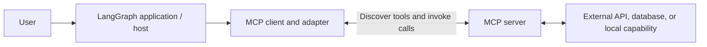
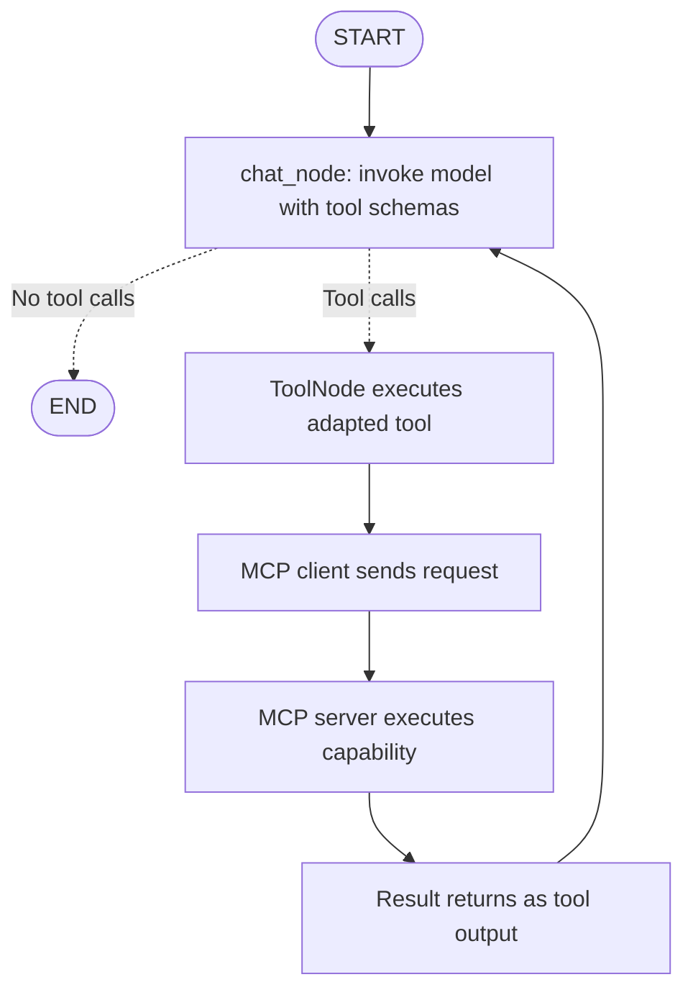

# MCP in LangGraph

## 1. MCP improves how we integrate tools

You can think of **Model Context Protocol (MCP) as an improvement in how tools are connected to an LLM workflow**. Instead of writing a separate integration inside every chatbot, an application connects to an MCP server that exposes capabilities through a standard interface.

More precisely, MCP is an open protocol, not a replacement for the idea of tools. A tool still performs a task. MCP standardizes how an application discovers and calls tools supplied by another component. Servers can also expose resources and prompts, although these notes focus on tools. [Official MCP server concepts](https://modelcontextprotocol.io/docs/learn/server-concepts).

The important change is where integration work lives:

```text
Direct integration:
LangGraph application -> custom GitHub tool -> GitHub API

MCP integration:
LangGraph application -> MCP client -> MCP server -> GitHub API
```

In the direct approach, your application owns the code that understands GitHub's API. In the MCP approach, that implementation can live in a separately maintained server, while your application uses the server's tool interface.

## 2. The maintenance problem with custom tools

Suppose you write a tool that searches GitHub issues. It sends an HTTP request, supplies authentication, parses the response, and returns selected fields to the model.

```python
# Conceptual example, not an actual GitHub endpoint or response format.
def search_issues(query):
    response = call_service_api(query)
    return response["items"]
```

Now imagine the external API changes its response shape, authentication requirements, or accepted parameters. The wrapper may fail or return incorrect data. Without suitable error handling, a tool failure can cause the workflow to fail too.

If five applications each contain their own wrapper, several teams may need to fix and redeploy similar code. The problem is **tight coupling and duplicated maintenance**, rather than tools being inherently unreliable.

This is not the only possible design for normal tools: a shared library or service can also centralize integration logic. MCP adds a standardized protocol so compatible applications do not all need a custom connector to that service.

## 3. How MCP changes the GitHub example

Imagine an MCP server exposing a stable tool contract:

```text
Tool: search_issues
Input: query
Output: normalized issue results
```

The server contains the service-specific implementation. Your LangGraph application loads the exposed tool and makes it available to the model.

If the upstream API changes, the server maintainer can update the implementation while preserving the same tool name, argument schema, and result meaning. Compatible applications can then continue using the same interface.

```text
GitHub API changes
    -> server implementation is updated
    -> server preserves the public tool contract
    -> application can keep using that contract
```

**MCP does not automatically repair API changes or guarantee uninterrupted connectivity.** Someone still has to maintain the server. A broken upstream API, unavailable server, expired credential, or incompatible tool-schema change can still break calls. A local server may require a package update or restart before its fix takes effect.

The benefit is that maintenance can be centralized behind a stable boundary. It is not eliminated.

## 4. MCP host, client, and server



### Host: the application coordinating the experience

In this example, the host is your AI application. It owns the user interaction, model calls, workflow, and decisions about which capabilities to expose.

### Client: the connection component

The client communicates with a server, obtains its tool definitions, sends invocation requests, and receives results. An adapter translates those definitions and calls into objects the LangChain/LangGraph tool machinery can use.

### Server: the capability provider

The server exposes tools and implements or delegates their behavior. It may handle API requests, response normalization, and service-specific errors. Its responsibilities depend on its implementation: MCP itself does not supply retries, caching, or business logic for every service.

The host can use several server connections. A server is a program providing capabilities; it does not have to run on a separate remote machine. [Official MCP architecture](https://modelcontextprotocol.io/docs/learn/architecture).

## 5. What does the client configuration contain?

Client setup usually describes **how to reach the server**, rather than how to implement each service operation.

For a local subprocess, configuration identifies an executable, script arguments, and sometimes environment variables. For a remote service, it identifies a URL and the required authentication setup.

| Client-side concern | Server-side concern |
| --- | --- |
| Server location and transport | Implementation of exposed capabilities |
| Discovering/selecting tools | External API request construction |
| Connecting tools to the graph | Service-specific response handling |
| Supplying appropriate connection credentials | Applying service access rules |
| Handling unavailable capabilities in the application | Maintaining compatibility with upstream systems |

The client is not always “just config.” You still need model setup, graph wiring, authentication, lifecycle management, error handling, and an appropriate user interface. MCP reduces repeated integration work; it does not remove application engineering.

## 6. Local MCP servers

A local server runs on the same machine as the client application. A common transport is **stdio**, where the client launches a subprocess and communicates through its standard input and output.

```text
LangGraph app -> local MCP client -> local server process -> capability
```

Local servers are useful for development, local files, scripts, or capabilities that should execute in the application's environment. A locally running server can still contact remote APIs, so “local server” does not necessarily mean “offline.”

In the older adapter configuration used by this project's backend, a local entry has this shape:

```python
import sys

local_server_config = {
    "arith": {
        "transport": "stdio",
        "command": sys.executable,
        "args": ["C:/absolute/path/to/math_server.py"],
    }
}
```

The path is a placeholder. It must point to an existing server script, and its Python environment must have the required dependencies. Merely placing a filename in configuration does not create the server.

## 7. Remote MCP servers

A remote server runs as a reachable service. The client uses its endpoint rather than launching its process. Streamable HTTP is a common transport for this arrangement.

```text
LangGraph app -> MCP client -> HTTPS MCP endpoint -> external service
```

This is useful when several applications should use one centrally deployed integration or when a provider operates the server for you.

An illustrative older-adapter configuration looks like:

```python
remote_server_config = {
    "issues": {
        "transport": "streamable_http",
        "url": "https://example.com/mcp",
    }
}
```

The URL is a placeholder, not a working GitHub server. Real endpoints may require OAuth, tokens, or other supported connection settings. A remote server can simplify client installation, but adds network availability and service operation dependencies.

Local and remote describe deployment location; transport describes communication. A local process could also expose HTTP. Use the transport supported by the server instead of assuming a different transport will work at the same URL.

## 8. How MCP tools fit into the LangGraph loop

MCP changes the source and execution boundary of tools. It does not replace the chat/tools loop explained in the tools notes.



The client discovers tools, the adapter exposes compatible tool objects, and the model receives their schemas. If the model requests one, `ToolNode` invokes its adapter wrapper. The request reaches the server, and the result comes back into graph state so the model can answer or request another tool.

`tools_condition` still inspects pending tool calls. It does not need a different reasoning process because the tool happens to be supplied through MCP.

## 9. Understanding the backend already in this folder

[langgraph_mcp_backend.py](langgraph_mcp_backend.py) uses `MultiServerMCPClient` from `langchain_mcp_adapters`. Its overall pattern is:

```python
# Integration fragment illustrating the existing adapter style.
from langchain_mcp_adapters.client import MultiServerMCPClient

client = MultiServerMCPClient(server_config)
mcp_tools = await client.get_tools()
tools = [*local_tools, *mcp_tools]
llm_with_tools = llm.bind_tools(tools)
```

Here, `server_config`, `local_tools`, and `llm` must already be defined. The `await` belongs inside an async function. This fragment is not a standalone script.

The backend then registers the combined tools with `ToolNode`, routes from chat using `tools_condition`, and adds the tools-to-chat return edge. Its dedicated async loop bridges asynchronous backend work and the frontend. MCP integration does not require every application to use that particular threading design.

### Configuration details to understand before running it

The existing local server entry points to a developer-specific macOS path and uses `python3`. Adapt the command and path to the machine running the app. The remote entry also requires a compatible, available server; its availability has not been tested here.

The backend currently catches tool-discovery exceptions and returns an empty list. That allows its ordinary tools to remain available, but can make an MCP connection failure look like successful startup with fewer capabilities. A useful application should make that degraded state visible in logs or its interface.

### Current integration versus the older adapter

The official adapter repository is now archived and directs new development toward `langchain[mcp]`. The existing backend has not been migrated by these notes. [Adapter repository and migration notice](https://github.com/langchain-ai/langchain-mcp-adapters).

The current documentation introduces the beta `langchain.mcp.MCPAdapter` API in LangChain 1.4+. It can discover server tools and adapt them for LangChain workflows. [Current integration documentation](https://docs.langchain.com/oss/python/langchain/mcp).

```python
# Current API fragment; requires a compatible installed version.
from langchain.mcp import MCPAdapter


async def discover_tools():
    async with MCPAdapter("https://example.com/mcp") as adapter:
        tools = await adapter.list_tools()
        return tools
```

This uses a placeholder endpoint and demonstrates discovery, not a complete chatbot. Do not mix configuration formats or lifecycle assumptions from different library versions without checking their documentation.

## 10. Why use MCP instead of direct custom tools?

### Reuse one integration across applications

Imagine a documentation assistant, an issue triage assistant, and a release assistant all needing the same issue lookup capability. A maintained server can expose it once rather than each application implementing its own upstream connector.

### Reduce coupling to service implementation details

If the server preserves its contract, application graph code can remain focused on the workflow while server maintenance handles upstream changes. This makes ownership clearer: workflow developers maintain orchestration, and integration maintainers manage the service boundary.

### Discover capabilities through a common interface

Instead of hard-coding a wrapper for every remote function, a client can obtain available tool names, descriptions, and input schemas. The application should still select which tools to expose; discovering a tool does not require enabling it for every user or task.

### Separate deployment and dependencies

A remote integration can run with its own dependencies and deployment schedule. Applications need the appropriate client integration rather than every service SDK. Local servers offer a similar process boundary while still requiring local installation and maintenance.

### Support a mixed tool collection

You can combine MCP tools with ordinary functions. A small local calculation does not need a server just because another capability uses MCP.

These advantages are strongest when integrations are reused, maintained independently, or shared across hosts. They are architectural benefits rather than a guarantee of better model reasoning.

## 11. When normal tools are the better choice

| Situation | Reasonable starting choice |
| --- | --- |
| One small helper used only in this application | Ordinary tool function |
| Existing internal function with no reuse requirement | Ordinary tool function |
| Shared integration used by several AI applications | Maintained MCP server |
| Provider offers a suitable, maintained MCP endpoint | Consider MCP after checking its capabilities |
| Very latency-sensitive local calculation | Direct function avoids an extra boundary |
| No maintained server exists for the required action | Write a direct tool, or build a server if reuse justifies it |

MCP can add connection setup, serialization, process or network overhead, and an extra component to operate. A direct tool may be simpler and entirely appropriate. MCP is not automatically faster, cheaper, more secure, or more reliable.

## 12. What MCP does not solve by itself

An external service can still be unavailable or rate-limited. Credentials can expire. Server tool schemas can change. A model can select the wrong tool or supply invalid arguments. The application still needs sensible failure handling and tests for important workflows.

Connecting to a server also does not authorize every exposed action. Select trusted servers, expose only appropriate capabilities, and apply the application's access rules. Tool results are external data; they should not override the application's instructions merely because they came through MCP.

MCP also does not replace chat persistence. Thread IDs and checkpointers still determine how LangGraph retains conversation state. Server sessions and conversation threads are separate concepts.

## 13. The GitHub example to remember

```text
Without a shared integration boundary:
API change -> fix each affected application wrapper

With a maintained MCP server and stable contract:
API change -> fix the server implementation
           -> compatible clients can keep their workflow interface
```

**Use MCP when a standard, reusable boundary makes tool integration easier to maintain.** The server takes ownership of service-specific work, while the LangGraph application focuses on selecting capabilities, orchestrating calls, and presenting results.

## References

- [Official MCP architecture](https://modelcontextprotocol.io/docs/learn/architecture)
- [Official MCP server concepts](https://modelcontextprotocol.io/docs/learn/server-concepts)
- [LangChain MCP integration](https://docs.langchain.com/oss/python/langchain/mcp)
- [Older adapter repository and migration notice](https://github.com/langchain-ai/langchain-mcp-adapters)

Examples are explanatory fragments and were not run here. No local server was launched, no remote MCP endpoint was contacted by application code, and the existing backend files were not changed.
