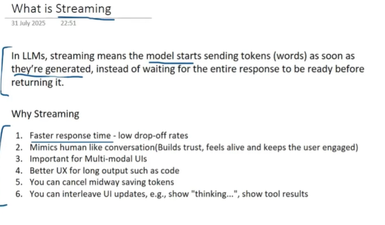

# Streaming in LLMs and LangGraph

## 1. Understanding the picture first



The picture introduces streaming as sending model output progressively while it is generated, instead of waiting for the complete answer before returning anything. It then lists six reasons to use it. This section explains each point before moving to implementation details.

### 1.1 What streaming means

Suppose a user asks, "Explain how a RAG chatbot works."

With a non-streaming response, the application waits for generation to finish and then displays the full answer. With streaming, the application receives successive pieces and can display them while generation continues.

```text
Non-streaming:
Question -> wait for generation -> display the complete answer

Streaming:
Question -> first piece -> next piece -> next piece -> completion
             user can start reading while generation continues
```

The picture says "tokens (words)." That is a useful simplification, but a token can be a word, part of a word, punctuation, or another unit. A delivered chunk may contain several tokens, no visible text, or metadata. Chunk boundaries are not guaranteed to match words or sentences.

For example, the visible sentence could arrive as these illustrative chunks:

```text
"A R" + "AG chatbot" + " retrieves" + " relevant documents."
```

Append text chunks as delivered. Adding a space between every chunk would corrupt some outputs.

### 1.2 Why streaming? Point 1: Faster response time

The main benefit is earlier visible feedback. A user can begin reading before the full answer is ready, reducing the impression that the application is frozen.

Consider this illustrative timing:

| Measurement | Non-streaming UI | Streaming UI |
| --- | --- | --- |
| First visible answer text | At 8 seconds | At 1 second |
| Complete answer available | At 8 seconds | At 8 seconds |

The generation duration is the same in this example. Streaming improves the wait until useful output appears; it does not inherently make the model generate faster. Retrieval, provider queues, and other work may still delay the first text chunk.

The picture links this to lower drop-off rates. A responsive experience may help retain users, but the actual effect should be measured in the application rather than treated as guaranteed.

### 1.3 Point 2: A more conversational experience

Progressive text makes a conversation feel responsive. The user sees that the assistant is working and can begin understanding the answer immediately.

For example, a tutoring assistant can start its explanation with a short definition while generating the example that follows. This can be easier to follow than staring at an empty screen and then receiving a large block of text.

Trust still depends on accuracy, clarity, and honest status messages. A typing effect alone does not make an answer trustworthy.

### 1.4 Point 3: Useful for multimodal interfaces

Multimodal applications handle more than text: audio, images, video, and combinations of these. Incremental delivery can support responsive voice playback or progressive presentation of supported media.

Imagine a voice assistant responding to a spoken question. If its model and audio pipeline support streaming, playback can begin before all audio is generated. The exact behavior depends on provider and transport support; text streaming does not automatically enable audio or image streaming.

### 1.5 Point 4: Better experience for long outputs such as code

Long answers create longer periods of silence when displayed only at completion. Streaming lets users inspect the opening explanation, function signature, or first section while later sections are still being produced.

However, partial code may have unfinished strings, incomplete indentation, or missing closing brackets. Display it as work in progress. Treat it as executable only after generation finishes and the code has been reviewed or validated.

The same principle applies to streamed JSON: a prefix of a valid JSON object is often not valid JSON itself.

### 1.6 Point 5: You can cancel midway, potentially saving tokens

A user may realize that an answer is going in the wrong direction and press Stop. Stopping generation can avoid producing the remaining unwanted output.

The saving is conditional. Hiding text or stopping a frontend loop does not prove that the backend or provider stopped generating. Cancellation needs to propagate through the application, graph execution, and provider connection where supported. Already generated or billed tokens remain consumed, and some in-flight work may finish.

A useful Stop flow is:

```text
User presses Stop
    -> UI sends cancellation
    -> backend cancels the active operation
    -> upstream stream is closed or cancelled where supported
    -> UI marks the answer as stopped
```

### 1.7 Point 6: Interleave UI updates and tool results

An agent may spend time searching documents, calling tools, or processing results before it can answer. Streaming can carry application progress events as well as model text.

```text
Status: Searching the policy documents...
Status: Found three relevant documents.
Status: Checking order details...
Answer: Your order qualifies because...
```

Use meaningful labels tied to real events. A generic "Thinking..." indicator is a status label, not access to the model's private reasoning. Keep progress messages, tool results, and answer text distinct so the interface can render each appropriately.

## 2. A more precise definition

**Streaming is incremental delivery of data or events before the overall operation completes.** In LLM applications, the stream may contain response text, tool-call fragments, progress information, or completion and error events.

Streaming is a delivery pattern. It does not guarantee correctness, faster total execution, parallel processing, or persistent memory. [OpenAI streaming guide](https://developers.openai.com/api/docs/guides/streaming-responses).

## 3. How streaming works from model to screen

```text
Model/provider
    -> backend receives chunks or events
    -> application selects and forwards relevant events
    -> network transport delivers them
    -> frontend updates the display
```

Every layer matters. A model can stream successfully while a backend buffers the entire response. A proxy can buffer outgoing data. A frontend can collect chunks without rendering them. In each case, the user still sees a delayed answer.

True end-to-end streaming requires incremental handling throughout the path. Printing a completed answer one character at a time is a visual animation; it does not provide early access to newly generated output.

## 4. Important terms and measurements

| Term | Meaning | Why it matters |
| --- | --- | --- |
| Time to first token (TTFT) | Time until the first model token is received, using a defined measurement boundary | Helps identify initial generation delay. |
| Time to first visible text | Time from the user's action until answer text appears | Captures the user's actual wait, including application overhead. |
| Inter-chunk delay | Time between successive received chunks | Large gaps can make output feel stalled. |
| Total response time | Time until the operation completes | Streaming does not automatically reduce it. |
| Throughput | Output generated or delivered per unit of time | Helps assess sustained generation speed. |
| Buffering | Holding data before forwarding or rendering it | Can hide streaming benefits. |
| Backpressure | Handling a producer that emits faster than a consumer can process | Prevents unbounded queues and memory growth. |

Be explicit about timing boundaries. Provider TTFT and browser time to first visible text measure different parts of the journey.

## 5. Streaming compared with other concepts

| Concept | What changes? | Example |
| --- | --- | --- |
| Streaming | Results arrive incrementally. | Show answer chunks as they arrive. |
| Asynchronous execution | A task can wait without blocking other compatible work. | Handle other requests while awaiting a network event. |
| Parallel execution | Independent work overlaps. | Query two document sources concurrently. |
| Persistence | State survives according to a storage/checkpoint strategy. | Continue a conversation using saved state. |

An asynchronous call can still return only a complete answer. A synchronous iterator can still stream. Parallel retrieval may shorten a request without streaming any user-facing text. Choose each capability according to the problem it solves.

## 6. Streaming in LangGraph

LangGraph can expose model output and graph progress. Choose the type of information the consumer needs rather than assuming every graph event belongs in the answer panel.

### 6.1 Common stream modes

| Mode | Useful for |
| --- | --- |
| `messages` | Model message chunks with metadata. |
| `updates` | Changes returned by graph nodes. |
| `values` | Full graph-state snapshots. |
| `custom` | Application-defined progress events. |
| `debug` | Detailed execution investigation. |

A node update and a model token are different events. If a node makes one long model call, waiting for its completed state update does not provide the same experience as consuming its message chunks.

**Version note:** official documentation now recommends the event-streaming API for new applications on LangGraph 1.2+. The examples below deliberately teach the stream-mode API. They use its explicit `version="v2"` format, which requires LangGraph 1.1+ and wraps events in dictionaries with `type`, `ns`, and `data`. Older/default v1 examples have different output shapes. [LangGraph streaming documentation](https://docs.langchain.com/oss/python/langgraph/streaming).

### 6.2 Complete local example without a model or API key

This example separates progress notifications from completed state changes. It does not generate LLM tokens; it demonstrates how a graph delivers different event types.

Install the dependency in your chosen Python environment:

```powershell
python -m pip install "langgraph>=1.1,<2"
```

```python
from typing import TypedDict

from langgraph.config import get_stream_writer
from langgraph.graph import END, START, StateGraph


class StudyState(TypedDict):
    topic: str
    outline: str
    summary: str


def plan(state: StudyState):
    writer = get_stream_writer()
    writer({"stage": "planning", "message": "Preparing an outline"})
    return {"outline": f"Definition and example of {state['topic']}"}


def summarize(state: StudyState):
    writer = get_stream_writer()
    writer({"stage": "writing", "message": "Preparing the summary"})
    return {"summary": f"Study outline: {state['outline']}"}


builder = StateGraph(StudyState)
builder.add_node("plan", plan)
builder.add_node("summarize", summarize)
builder.add_edge(START, "plan")
builder.add_edge("plan", "summarize")
builder.add_edge("summarize", END)
graph = builder.compile()

initial_state = {"topic": "streaming", "outline": "", "summary": ""}

for event in graph.stream(
    initial_state,
    stream_mode=["custom", "updates"],
    version="v2",
):
    if event["type"] == "custom":
        print("STATUS:", event["data"]["message"])
    elif event["type"] == "updates":
        print("UPDATE:", event["data"])
```

Expected sequence:

```text
STATUS: Preparing an outline
UPDATE: {'plan': {'outline': 'Definition and example of streaming'}}
STATUS: Preparing the summary
UPDATE: {'summarize': {'summary': 'Study outline: Definition and example of streaming'}}
```

The graph is small, so its events may arrive almost immediately. Their purpose is to show the distinction between a progress notification and a returned state update.

### 6.3 Consuming model text from an existing graph

The following fragment assumes you already have a compiled `chatbot` graph with a model node named `answer`. The model integration must support the relevant streaming behavior.

```python
inputs = {"messages": [{"role": "user", "content": "Explain streaming."}]}

for event in chatbot.stream(inputs, stream_mode="messages", version="v2"):
    message_chunk, metadata = event["data"]

    # Select the answer node when the graph also has other model calls.
    if metadata.get("langgraph_node") != "answer":
        continue

    # This renderer handles text-only string content.
    if isinstance(message_chunk.content, str):
        print(message_chunk.content, end="", flush=True)
```

Replace `answer` with the actual node name. Multi-step agents may emit output from several model calls, so filtering prevents internal or unrelated generations from being concatenated into one user-visible answer. Non-string content requires a renderer that understands the provider's content blocks.

### 6.4 Asynchronous consumption

Inside an async function, the matching pattern is:

```python
async for event in chatbot.astream(
    inputs,
    stream_mode="messages",
    version="v2",
):
    message_chunk, metadata = event["data"]
    if metadata.get("langgraph_node") == "answer":
        if isinstance(message_chunk.content, str):
            print(message_chunk.content, end="", flush=True)
```

This is an integration fragment, not a standalone script. Prefer Python 3.11+ for async examples; older Python versions need extra attention to configuration propagation. [LangGraph streaming guide](https://docs.langchain.com/oss/python/langgraph/streaming).

## 7. Designing the user interface

Maintain separate UI states such as waiting, streaming, completed, stopped, and failed. These states tell the user whether more text is expected.

A typical display flow is:

1. Add the user's message.
2. Create one assistant response container.
3. Show an honest status while waiting for answer text.
4. Append text deltas into the same response.
5. Show tool progress separately when useful.
6. Mark completion, cancellation, or failure explicitly.

Avoid creating a new chat message for every chunk. For long outputs, batch small rendering updates to reduce layout work. Screen readers should not announce every token separately; consider sentence-level or periodic announcements.

For this repository, `chatbot-in-langraph/streamlit_frontend.py` currently uses `chatbot.invoke(...)` and displays the answer after completion. A streaming adaptation would consume graph events and progressively update an assistant container. It would also need to preserve the completed or explicitly partial response in message history. These notes do not modify that application.

## 8. Transport choices

| Transport | Typical fit | Practical consideration |
| --- | --- | --- |
| Server-Sent Events (SSE) | Server-to-client event delivery | Browser-native EventSource is one-way; request design and authentication need care. |
| Streaming HTTP via Fetch | Consume a response body incrementally, including after a POST | Parse the actual event framing; a network chunk may split an event. |
| WebSocket | Bidirectional interactive communication | Requires connection lifecycle and reconnect handling. |

A provider SDK may handle framing for you. If parsing raw bytes, account for events split across network chunks and multi-byte characters split across reads. Use an incremental decoder rather than decoding each byte chunk independently.

## 9. Common problems and how to reason about them

| Symptom | Possible cause | What to inspect |
| --- | --- | --- |
| Answer appears all at once | Buffering or a non-streaming call somewhere in the path | Provider, backend forwarding, proxy, and frontend rendering. |
| Words contain unwanted spaces | A separator was added between deltas | Append chunks without inserting arbitrary spaces. |
| Answer appears twice | Both deltas and the final full message were appended | Choose a consistent delta/snapshot handling strategy. |
| Stop button hides output but work continues | Cancellation did not reach the backend/provider | Propagate cancellation and inspect upstream behavior. |
| Partial JSON fails to parse | The document is incomplete | Wait for completion or use a suitable incremental parser. |
| Several answers are mixed together | Multiple graph model calls feed one display | Filter by node or other routing metadata. |
| Output ends abruptly | Network failure, cancellation, or provider error | Distinguish failure from normal completion. |

Do not retry blindly after partial output. A new request can produce different text, and repeating a workflow may repeat tool side effects. Decide whether to restart, resume with supported infrastructure, or ask the user to retry, and communicate that state clearly.

## 10. Tool calls, validation, and persistence

Streamed tool-call arguments can arrive as fragments. An incomplete argument string should not be executed as a tool request. Assemble it, validate it, and execute only when the protocol indicates the call is ready and application rules permit it.

Likewise, a partial answer is not automatically a validated result. Applications requiring strict schemas or review may buffer selected output until validation completes. Streaming can still show safe status updates during that wait.

Streaming also does not automatically save conversation history. Persistence and checkpointing need their own design. Keep the distinction between text already displayed and graph state durably committed, especially if a run is interrupted.

## 11. Measuring whether streaming helps

Compare the old and new experience on representative prompts, including long answers and tool-heavy requests. Measure first visible text, total duration, inter-chunk gaps, cancellation behavior, and failure handling.

A useful experiment might ask: "Do users get a helpful first sentence sooner, and can they tell when a tool is still running?" This evaluates the experience more directly than checking whether an iterator yields multiple chunks.

LangSmith traces can help investigate where a graph spends time, while browser-side measurements capture the final rendering delay. The two views help locate whether a slow experience begins in retrieval, generation, transport, or the UI.

## 12. References

The supplied picture is the starting learning reference. The examples and qualifications above expand its concepts.

- [LangGraph streaming: stream modes and output formats](https://docs.langchain.com/oss/python/langgraph/streaming)
- [LangChain streaming](https://docs.langchain.com/oss/python/langchain/streaming)
- [OpenAI streaming API responses](https://developers.openai.com/api/docs/guides/streaming-responses)

Check your installed package version before copying an API example. The complete local example needs no API key; the model-streaming fragments require an existing graph, a suitable model integration, and its normal configuration.
