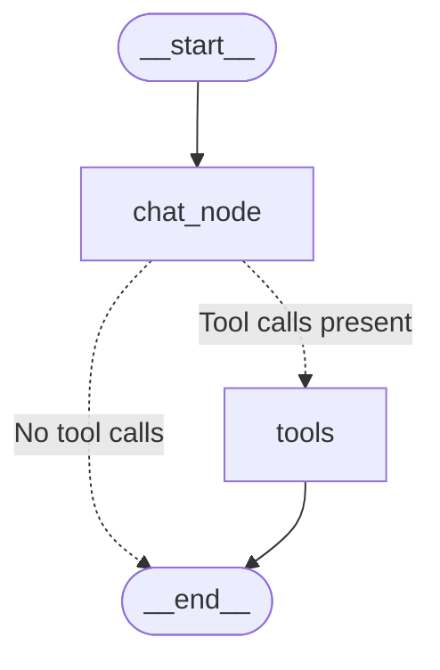
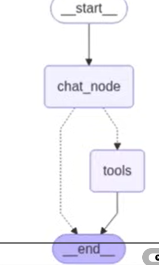
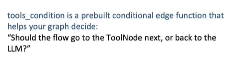
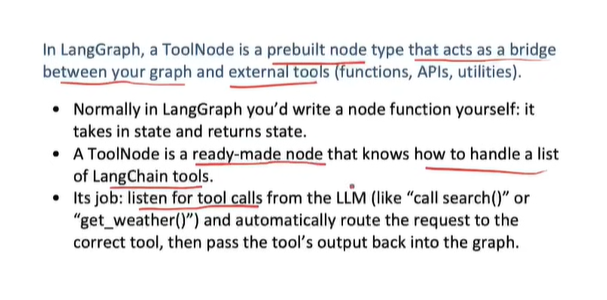
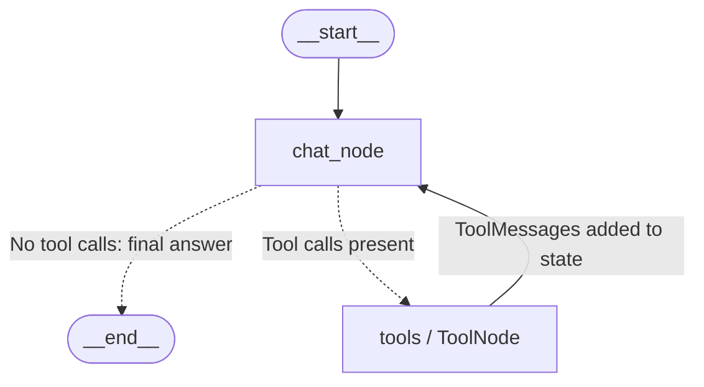

# Tools in LangGraph

## 1. Draw the first picture



This redraw follows Picture 1: the chat node either ends the conversation turn or sends work to the tools node, which then ends the flow. We will improve this graph later by returning from tools to the chat node.



## 2. What happens when a user enters a query?

The query first reaches `chat_node`. This node invokes the language model with the conversation and the descriptions of the available tools. The model can produce a normal answer or request a tool.

| User query | Possible model response | Next destination |
| --- | --- | --- |
| Explain a Python list. | An ordinary assistant answer | `END` |
| Look up the current weather in Lahore. | A structured weather-tool request | `tools` |

These are illustrative choices, not guaranteed behavior for every model. Tool availability, descriptions, instructions, and model capabilities influence the decision.

### Normal-answer path

```text
User -> chat_node calls LLM -> AI answer without tool calls -> END
```

### Tool path

```text
User -> chat_node calls LLM -> AIMessage requests a tool
     -> conditional routing -> ToolNode executes the request
```

**The LLM is called on both paths.** The graph does not first choose between calling an LLM and calling a tool. The chat node invokes the LLM; its response determines whether tool execution is needed next.

The model proposes what to do. A routing function reads that proposal, and the graph follows the corresponding edge.

## 3. What is a tool?

A tool is an application function exposed for a particular capability: searching documents, querying a database, calculating a value, or calling an API. Tools let the application perform work beyond generating text.

For example, a model should not invent an order's current delivery status. An order lookup tool can retrieve the actual information needed to answer.

```python
from langchain_core.tools import tool


@tool
def multiply(a: int, b: int) -> int:
    """Multiply two integers and return the product."""
    return a * b
```

The tool's name, description, and parameter schema describe its purpose to the model. The function body runs in application code when the requested call is executed.

## 4. How does the chat node decide whether tools are needed?

### 4.1 Bind tools to a capable model

With a LangChain model integration supporting tool calling:

```python
tools = [multiply]
llm_with_tools = llm.bind_tools(tools)


def chat_node(state):
    response = llm_with_tools.invoke(state["messages"])
    return {"messages": [response]}
```

Binding makes tool definitions available to the model. It does not execute the functions by itself.

### 4.2 Inspect the model's response

A direct answer has no pending tool calls:

```text
AIMessage:
    content = "A list is an ordered collection."
    tool_calls = []
```

A tool request contains structured information:

```text
AIMessage:
    tool_calls = [
        {
            "name": "multiply",
            "args": {"a": 12, "b": 7},
            "id": "call_example_1",
            "type": "tool_call"
        }
    ]
```

The name identifies the tool, the arguments supply its inputs, and the call ID identifies that particular request. A tool-requesting message may also contain text; routing should inspect `tool_calls`, not assume an empty content string means a tool is needed.

The LLM's choice can be wrong. Clear descriptions and appropriate validation help the application handle those choices reliably.

## 5. What is `tools_condition`? — Picture 3



`tools_condition` is a prebuilt routing function used with conditional graph edges. In the standard message-based pattern, it examines the latest assistant message:

- If it contains tool calls, return `"tools"`.
- Otherwise, return `"__end__"`.

It does not generate an answer, execute a tool, or ask another LLM to reconsider the user query. It checks the response already generated by the chat node. [Official tools_condition reference](https://reference.langchain.com/python/langgraph.prebuilt/tool_node/tools_condition).

The picture says “ToolNode next, or back to the LLM?” That is a loose description of the overall loop. More precisely, **this condition routes from the chat node to tools or END**. A separate tools-to-chat edge returns execution to the LLM after tool execution.

```python
from langgraph.graph import END
from langgraph.prebuilt import tools_condition

builder.add_conditional_edges(
    "chat_node",
    tools_condition,
    {"tools": "tools", "__end__": END},
)
```

The mapping connects returned labels to graph destinations. If you name your tool-execution node differently, map `"tools"` to that node's name.

### Follow the condition through two examples

```text
Question: Explain a Python list.
Model response: ordinary answer
Latest tool_calls: empty
Condition result: __end__

Question: Use multiply to calculate 12 times 7.
Model response: multiply(a=12, b=7) request
Latest tool_calls: contains that call
Condition result: tools
```

The model makes the semantic choice; the condition performs structural routing based on that choice.

## 6. What is `ToolNode`? — Picture 2



As the picture explains, `ToolNode` is a prebuilt node that handles tool execution. Normally, you write a graph node function yourself. Here, you register available tools with a ready-made execution component:

```python
from langgraph.prebuilt import ToolNode

builder.add_node("tools", ToolNode([multiply]))
```

In this message-based pattern, it reads the requested tool name and arguments, dispatches the matching registered function, and returns the result as a `ToolMessage`. It supports multiple calls and configurable error handling. [ToolNode API reference](https://reference.langchain.com/python/langgraph.prebuilt/tool_node/ToolNode).

### 6.1 Follow one request through execution

```text
AIMessage requests:
    name = multiply
    args = {a: 12, b: 7}
    id = call_example_1

ToolNode:
    finds multiply among registered tools
    executes multiply(a=12, b=7)
    receives 84

ToolMessage:
    content represents 84
    tool_call_id = call_example_1
```

The `tool_call_id` links the result to the request. This becomes especially useful when an assistant requests several tools in one message.

### 6.2 What does “listens for tool calls” mean?

The picture uses “listens” informally. `ToolNode` is invoked when graph execution reaches that node; it is not necessarily a continuously running background listener. When invoked, it processes the supplied tool requests and returns their results into the graph.

### 6.3 What does it leave to the chat node?

In this workflow, the tools node does not decide whether another tool is needed afterward or compose the final explanation. The next model call can make those decisions using the results. Graph edges determine whether that next call happens.

## 7. Why improve the initial graph?

The original path ends immediately after executing a tool:

```text
chat_node -> tools -> END
```

The final graph state may contain a tool result, but the model has not interpreted it. A frontend displaying only assistant text may have no final conversational answer to show.

For a tool-using conversational assistant, return the tool result to the chat node:

```text
chat_node -> tools -> chat_node
```

## 8. Draw the improved graph with a tools-to-chat edge



The key line is:

```python
builder.add_edge("tools", "chat_node")
```

Keep the conditional routing from chat to tools or end. Replace the original tools-to-end edge with this return edge; do not keep both as unconditional edges.

## 9. Reason 1: refine and interpret the tool output

Tool results can be numbers, raw text, structured data, or errors. They may not directly answer the user's question.

```text
User: What is the weather in Lahore, and should I take an umbrella?

Illustrative tool output:
{"city": "Lahore", "temperature_c": 28, "rain_probability": 0.8}

Possible assistant answer after seeing the result:
The lookup reports 28°C and an 80% chance of rain in Lahore.
Taking an umbrella would be sensible.
```

The model turns returned data into an explanation relevant to the request. It should preserve the actual evidence and avoid inventing details.

Some tools already return readable text, so refinement is not always necessary. The broader benefit is giving the model an opportunity to interpret evidence, combine results, and decide whether the task is complete.

## 10. Reason 2: enable multi-step tool execution

Suppose the user asks:

> Find the unit price of product ABC, then calculate the total for three units.

Available tools are `lookup_product` and `multiply`. The calculation depends on a value obtained from the lookup.

### First visit to chat_node

The model sees that the price is unknown and requests:

```text
lookup_product(product_code="ABC")
```

The condition detects a call and routes to tools.

### First tool execution

The lookup returns illustrative data:

```text
ToolMessage: {"product_code": "ABC", "unit_price": 25}
```

The tools-to-chat edge returns control to the chat node. The model is invoked again with the conversation, its previous request, and this result.

### Second visit to chat_node

Now the model can request:

```text
multiply(a=25, b=3)
```

The condition detects that call and sends execution back to tools.

### Second tool execution and final answer

The calculation returns `75`. The return edge invokes the chat node again. The model can now say:

```text
Three units cost 75, before any additional charges.
```

This answer has no tool calls, so the condition selects END.

```text
START
  -> chat_node: request product lookup
  -> tools: return unit price
  -> chat_node: request multiplication
  -> tools: return total
  -> chat_node: provide final answer
  -> END
```

Each iteration lets the model use newly available information. Without the return edge, the graph would stop after the initial lookup.

### Two tools do not always mean two iterations

If two tool calls are independent, the model may request both in one assistant message, and `ToolNode` can process multiple calls in that visit. Dependent calls often need another model turn because their inputs depend on earlier results. [Tool execution capabilities](https://reference.langchain.com/python/langgraph.prebuilt/tool_node).

## 11. Putting the graph together

The following integration example assumes `llm` is an already configured, tool-capable LangChain chat model. It defines the tools and graph, but leaves provider credentials and model selection to your existing setup. It has not been executed here.

```python
from typing import Annotated, TypedDict

from langchain_core.messages import BaseMessage, HumanMessage
from langchain_core.tools import tool
from langgraph.graph import END, START, StateGraph
from langgraph.graph.message import add_messages
from langgraph.prebuilt import ToolNode, tools_condition


@tool
def lookup_product(product_code: str) -> dict:
    """Look up an integer unit price using a product code."""
    catalog = {"ABC": 25, "XYZ": 40}
    if product_code not in catalog:
        return {"error": "Product not found"}
    return {"product_code": product_code, "unit_price": catalog[product_code]}


@tool
def multiply(a: int, b: int) -> int:
    """Multiply two integers, such as a unit price and quantity."""
    return a * b


class ChatState(TypedDict):
    messages: Annotated[list[BaseMessage], add_messages]


# Configure llm with your chosen tool-capable integration before this line.
tools = [lookup_product, multiply]
llm_with_tools = llm.bind_tools(tools)


def chat_node(state: ChatState):
    response = llm_with_tools.invoke(state["messages"])
    return {"messages": [response]}


builder = StateGraph(ChatState)
builder.add_node("chat_node", chat_node)
builder.add_node("tools", ToolNode(tools))
builder.add_edge(START, "chat_node")
builder.add_conditional_edges(
    "chat_node",
    tools_condition,
    {"tools": "tools", "__end__": END},
)
builder.add_edge("tools", "chat_node")
chatbot = builder.compile()

result = chatbot.invoke(
    {
        "messages": [
            HumanMessage(
                content=(
                    "Use lookup_product to find ABC's unit price, then "
                    "use multiply to calculate the total for three units."
                )
            )
        ]
    },
    config={"recursion_limit": 12},
)
print(result["messages"][-1].content)
```

The catalog is demonstration data. A real lookup tool would query the appropriate source. The exact model-generated call sequence can vary; if your application requires a guaranteed tool order, encode that order explicitly in its workflow.

### Why use add_messages?

The model needs the accumulating exchange:

```text
HumanMessage
AIMessage requesting tool 1
ToolMessage returning result 1
AIMessage requesting tool 2
ToolMessage returning result 2
AIMessage giving the final answer
```

The reducer merges new messages into existing state. Replacing the message list on every node return can remove information needed for the next iteration.

This example does not configure a checkpointer. State is maintained during this invocation; continuing separate chat turns with saved context requires checkpointing and the appropriate thread ID.

## 12. Common mistakes and practical limits

| Mistake | Consequence | Correction |
| --- | --- | --- |
| No tools bound to the model | It may produce only ordinary text. | Bind tools to a capable model. |
| A bound tool is missing from ToolNode | The request cannot be dispatched correctly. | Register matching implementations. |
| Route before the model response | The model's decision is not available yet. | Route after chat_node. |
| End immediately after tool execution | No final model interpretation occurs. | Return to chat for the conversational loop. |
| Drop earlier messages | The model loses prior requests and results. | Use an appropriate message reducer. |
| No stopping strategy | Repeated tool requests may continue the loop. | Configure execution limits and handle failures. |

A recursion limit guards graph execution steps; it is not a direct tool-call count. Several tools can be requested in one turn, and graph steps include other work. Handle a limit failure explicitly rather than presenting an unfinished run as a completed answer.

Tool arguments are model-generated inputs. Validate them and apply the application's usual authorization before actions execute. `ToolNode` provides execution machinery, not permission to perform every requested action.

## 13. Remember the responsibilities

| Component | Responsibility |
| --- | --- |
| chat_node and its LLM | Produce an answer or request tools using the current context. |
| tools_condition | Route to tools when calls exist, otherwise END. |
| ToolNode | Execute registered tools with the supplied arguments. |
| ToolMessage | Carry a tool result back into the message state. |
| tools-to-chat edge | Let the model interpret results and request another step. |

The model proposes, the condition routes, the tool node executes, and the return edge enables another model decision. Together, these pieces form a tool-using loop.

## References

- [tools_condition reference](https://reference.langchain.com/python/langgraph.prebuilt/tool_node/tools_condition)
- [ToolNode reference](https://reference.langchain.com/python/langgraph.prebuilt/tool_node/ToolNode)
- [Prebuilt tool execution module](https://reference.langchain.com/python/langgraph.prebuilt/tool_node)

The supplied pictures are learning references. The two Mermaid diagrams redraw the initial flow and its improved conversational loop.
